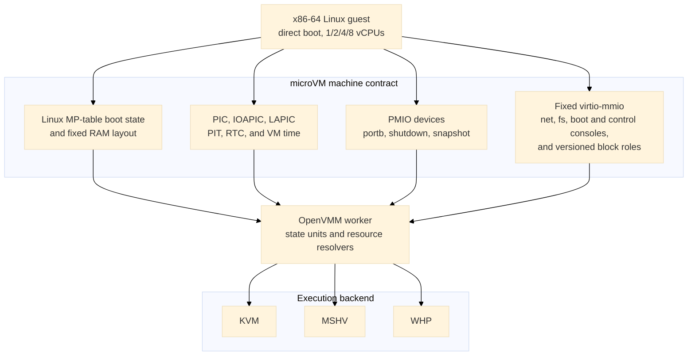
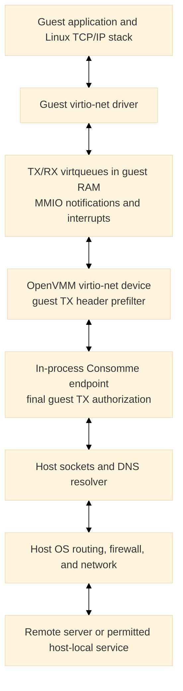
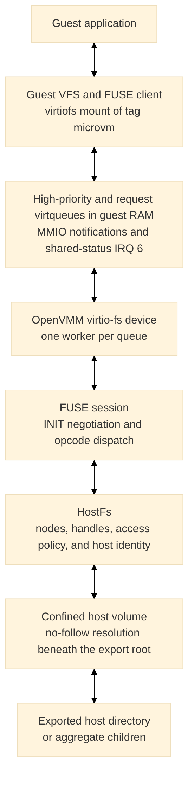
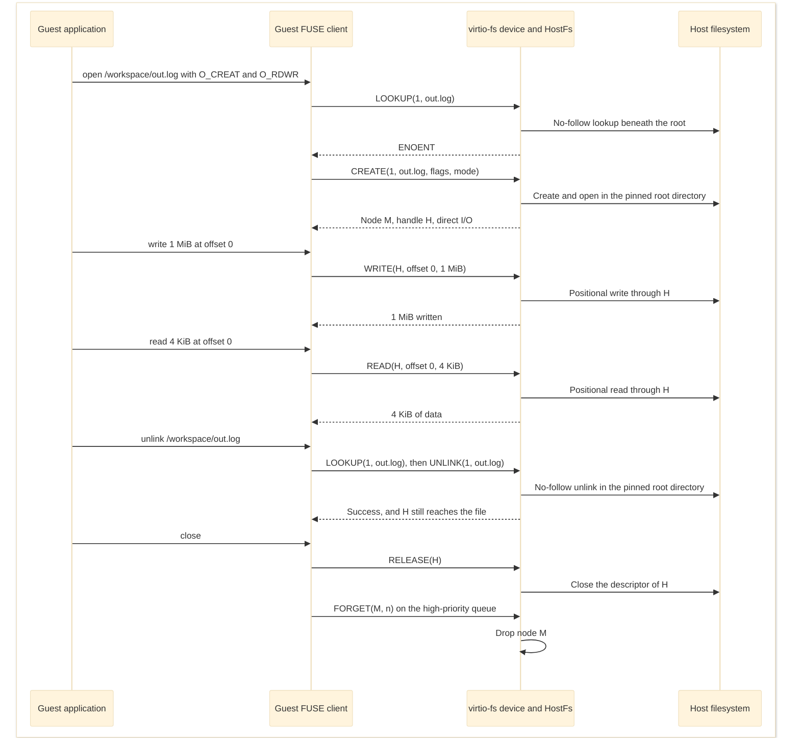

# Machine and device ABI

[Design index](../design.md)

## Architectural devices

The microVM base chipset contains exactly this allowlist:

- generic PIC and IOAPIC;
- the selected hypervisor's LAPIC;
- i8253 PIT on IRQ 0;
- generic programmable CMOS RTC anchored to UTC;
- raw bidirectional portb;
- status-carrying shutdown port; and
- guest snapshot-request port.

The RTC defaults to BCD, 24-hour fields with status B `0x02`. PIC, IOAPIC, PIT,
RTC, LAPIC, and VM time use common OpenVMM device and
state-unit machinery on every backend. IOAPIC saved state includes the
asserted level of every input line and reevaluates routing after restore, so a
level interrupt is neither lost nor treated as an edge while reconstructing
the backend. Serial UARTs, debugcon, Hyper-V power management, gameport, PCI,
firmware helpers, and standard-PC missing-port shims are absent.

The guest's clocks follow [NVX time ABI v1](time-abi.md) on every backend: a
minimal Hyper-V identity whose MSRs declare the TSC and LAPIC rates, served by
the `time-abi` state unit; the TSC as the only clocksource; the LAPIC timer in
one-shot mode at the backend's fixed rate (1 GHz on KVM, 200 MHz on MSHV and
WHP); and a PIT that the guest disables at boot. Capture rejects a periodic or
TSC-deadline LAPIC timer and a periodically counting PIT channel 0.



## PMIO devices

| Port | Device | Behavior |
| ---: | --- | --- |
| `0xe9` | portb data | Raw byte input and output; console reads consume one pending byte and zero-fill the remaining access width. With the restore packet or generation ID selected, a 1-, 2-, or 4-byte read returns that many bytes of the record, zero-filled past its end. |
| `0xea` | portb status | Bit 0 reports pending host input, bit 1 reports a fresh restore packet, bit 2 reports a processor target, bit 3 reports a memory target, bit 4 reports one or more memory-expansion ranges, bit 5 reports the fixed generation-ID selector, and bit 6 reports the time-sample window, which always exists. Writing `0xa5` after restore selects the one-time [restore packet](time-abi.md#restore-packet). Writing `0xa6` selects the current 16-byte generation ID; it may be selected repeatedly and remains stable for the lifetime of one VM process. Writing `0xa7` latches a fresh [time sample](time-abi.md#time-sample) into the window without changing the `0xe9` selection. |
| `0xeb` | portb time window | A 1-, 2-, or 4-byte read returns the next bytes of the latched time sample, zero-filled past its end or when none is latched. The window is not saved state. |
| `0x604` | shutdown | The first output byte becomes the process status carried with the VM power-off request. Reads return all ones. |
| `0x605` | snapshot request | Reads return all ones. Writes are coalesced and routed asynchronously to the capture controller. Zero requests fresh scratch and a nonzero first byte requests paired scratch. |

The portb receive and transmit buffers are each bounded at one MiB. Output
overflow drops the newest bytes and emits a rate-limited warning; input applies
backpressure by stopping host reads when its buffer is full. Pending bytes are
saved so capture does not silently lose VMM-owned I/O. While host input is
gated for a snapshot boundary or post-restore repair, portb stops reading its
host endpoint, returns zero for console data reads, and clears the
input-available status bit; guest output, the generation ID, any restore
packet, and the time-sample window remain available.

Guest-requested process exit drains the portb endpoint and, when present, its
host stdout relay before reporting completion. The combined drain has a
five-second deadline. Success preserves the guest's exit status; endpoint,
relay, or timeout failures become process-exit errors instead of silently
discarding final output. This is a portb/host-relay guarantee, not a general
drain of every virtio-console endpoint. Under the management RPC, a zero guest
status completes a pending wait and stops the server cleanly, while a nonzero
status or failed drain fails the pending wait and ends the server with an
error.

A snapshot-port write with no configured destination completes normally and
the guest continues. With a destination, the device permits at most one pending
transaction and defers completion long enough for the controller to establish
the exact post-`out` capture boundary. Repeated writes are coalesced. The PMIO
callback itself never pauses vCPUs, drains devices, hashes RAM, or writes files.
The scratch policy travels with the deferred boundary request. After a gated
restore, the same write acknowledges completion of guest repair.

## Fixed virtio-mmio transport

All eight fixed address slots are reserved, including the dedicated control
console at `0xd0007000..0xd0007fff` on IRQ 3 (shared status at `0x3001c`).
The window at `0xd0008000..0xd0008fff`, IRQ 13, and the shared-status word at
`0x30020` held a second virtio-fs slot in earlier releases; they are unused, and
a snapshot that recorded that slot no longer restores.
Every microVM cold-booted from the command line or the management RPC
instantiates the virtio-fs slot, so it is discoverable before capture even
without a host attachment; a restore keeps the slot only when the snapshot
recorded it. Several shares are children of one aggregate attachment on that
slot. Other optional devices are instantiated only when configured.
The control slot is instantiated for a control console, either a live
authenticated local endpoint on Linux or Windows or an explicitly disconnected
console. Every device uses virtio-mmio, is discovered only through
profile-owned command-line tokens, and has packed-ring support masked.
The MP table routes only the 16 ISA interrupts, and no device uses IRQ 13 on
KVM, MSHV, or WHP.

| Device | Stable identity | MMIO range | IRQ | Availability |
| --- | --- | ---: | ---: | --- |
| virtio-net | `net:microvm0` | `0xd0000000..0xd0000fff` | KVM/MSHV 10, WHP 5 | Optional |
| virtio-fs | `fs:microvm0` | `0xd0001000..0xd0001fff` | 6 | Reserved dormant slot; HostFs optional |
| virtio-console | `console:microvm-virtio0` | `0xd0002000..0xd0002fff` | 7 | Optional |
| `distro` virtio-blk | `blk:sandbox:distro` | `0xd0003000..0xd0003fff` | 4 | Optional read-only role |
| `runtime` virtio-blk | `blk:sandbox:runtime` | `0xd0004000..0xd0004fff` | 12 | Optional read-only role |
| `custom` virtio-blk | `blk:sandbox:custom` | `0xd0005000..0xd0005fff` | 9 | Optional read-only role |
| `scratch` virtio-blk | `blk:sandbox:scratch` | `0xd0006000..0xd0006fff` | 11 | Writable final role; required with blocks except in the RAM-backed overlay layout |
| Control virtio-console | `console:microvm-control0` | `0xd0007000..0xd0007fff` | 3 | Optional authenticated local endpoint |

Explicit placement metadata bypasses the standard sequential MMIO allocator.
The worker validates the complete device count, kind, bus, address, IRQ, and
feature policy before resolving devices.

`--microvm-sandbox-block ROLE:DISK` assigns each attachment by
role rather than option order:

| Role | MMIO range | IRQ | Access |
| --- | ---: | ---: | --- |
| `distro` | `0xd0003000..0xd0003fff` | 4 | Read-only |
| `runtime` | `0xd0004000..0xd0004fff` | 12 | Read-only |
| `custom` | `0xd0005000..0xd0005fff` | 9 | Read-only |
| `scratch` | `0xd0006000..0xd0006fff` | 11 | Writable |

Roles must be unique and supplied in fixed order; omitted lower-layer roles
leave their slots empty. A nonempty topology ends with scratch unless the
[RAM-backed overlay layout](cold-boot.md#effective-command-line) selects exactly
one read-only `distro` block. All four block IRQs use active-high edge
delivery. IRQ 12 avoids the RTC's exclusive IRQ 8.

The microVM keeps every fixed MMIO address and IRQ number and uses active-high edge
delivery for dedicated virtio IRQs. One little-endian, naturally aligned `u32`
per fixed slot resides in the reserved shared-status page:

| Slot | Status GPA |
| --- | ---: |
| virtio-net | `0x30000` |
| virtio-fs | `0x30004` |
| virtio-console | `0x30008` |
| `distro` block | `0x3000c` |
| `runtime` block | `0x30010` |
| `custom` block | `0x30014` |
| `scratch` block | `0x30018` |
| Control virtio-console | `0x3001c` |

OpenVMM publishes config-change and used-buffer bits with a sequentially
consistent compare-exchange loop. It pulses the device IRQ only when the old
word is zero. The specialized Linux driver consumes all pending bits with a
sequentially consistent `xchg` to zero, so steady-state handling performs no
interrupt-status read or interrupt-acknowledgement MMIO access. A host OR that
races the exchange is either included in the exchanged value or observes zero,
stores the bit, and emits a new edge. Device reset and teardown clear the word.
Snapshot quiesce saves the pending value in transport state; restore writes it
back without replaying an edge, and the machine contract records the interrupt
mode, page GPA, and page size.

### Block

Block devices are routed directly to virtio-mmio rather than VPCI. Packed rings
are unavailable. Each block has a stable role, MMIO address, IRQ, access mode,
and fixed feature mask.

#### Construction and discovery

Each role-bearing attachment must use its role's access mode. OpenVMM opens the
host storage through its generic disk interface and creates one single-queue
virtio-blk device per role at the role's fixed virtio-mmio slot. No PCI bus or
PCI enumeration is involved.

OpenVMM adds one profile-owned discovery token per block to the kernel command
line. The guest kernel creates the virtio-mmio device from that token,
negotiates features within the role's fixed set, and places the split
virtqueue in guest RAM. Guest device names are not role identities. The sandbox
launcher instead passes each role's MMIO address on the kernel command line,
and the guest agent maps that address to its block device. The agent mounts
lower roles read-only as EROFS and scratch read-write as ext4, then assembles
the [overlay root](sandbox-filesystem-and-agent-architecture.md#implemented-filesystem-bootstrap).

#### Guest-visible capabilities

Each role offers a fixed capability set: virtio 1.0 split rings with indirect
descriptors and event-index notification suppression, a per-request segment
limit, block-size and topology reporting, and a write-back cache with explicit
flush. Lower roles are also advertised as read-only. Discard is never offered,
even when the host storage could deallocate blocks. The device reports the
backing store's capacity and its logical and physical block sizes.

#### Request and completion path

The MMIO window is a control plane for device configuration and queue
notifications; block data never crosses it. A request is a descriptor chain in
guest RAM that holds a header with the operation and starting sector, any data
buffers, and a status byte. The guest publishes the chain and, unless the
device has suppressed notifications, notifies the queue. OpenVMM receives that
notification through a hypervisor doorbell when available and otherwise by
emulating the MMIO access. Either path wakes the device's I/O worker.

The worker reads requests directly from guest memory and services several
concurrently. It translates each request's virtio sector address to the
backing store's logical blocks and rejects a read or write that does not start
on a logical-block boundary or whose length is not a whole number of logical
blocks. It does not require alignment to the reported physical block size,
which is only an alignment hint for the guest. Accepted reads and writes
become asynchronous scatter-gather I/O that targets guest buffers directly
when their layout permits. Individual writes are not forced to stable
storage; a guest flush becomes a backend cache flush.

On completion, the device stores a success, I/O-error, or unsupported status in
the request, publishes one used-ring entry, and, unless the guest suppressed
the notification, signals the guest through the role's
[shared-status word and edge IRQ](#fixed-virtio-mmio-transport). The guest
driver therefore completes block I/O without reading or acknowledging
interrupt status through MMIO.

#### Host storage and access enforcement

Because the device depends only on OpenVMM's generic disk interface, its
guest-visible behavior is independent of the host storage type. The backend
sees block offsets and buffers; filesystem semantics remain entirely in the
guest. Without snapshot support, a role accepts any disk backend that OpenVMM
can open. Raw files use asynchronous kernel I/O on Linux, which can transfer
aligned buffers directly to and from guest memory, and positional file I/O on
worker threads on Windows, which copies through an intermediate buffer.

Read-only access is enforced at three layers: the guest is told that the device
is read-only, the device rejects write and discard requests, and OpenVMM opens
an existing host file without write access. Scratch is the only writable role.

A snapshot destination or restore makes every block snapshot-capable. Each
must then be a nonempty, 512-byte-aligned raw regular file that uses cached I/O
and is not reached through a final symbolic link. OpenVMM keeps that opened
file for identity hashing, flushing, and paired-scratch publication.

#### Snapshot contract and quiesce

The snapshot contract records the role, read-only flag, logical length,
logical and physical block sizes, and identity policy. Each consumed block uses
either whole-file SHA-256 or the caller-authenticated immutable storage
generation supplied at capture. Generation mode requires all bound roles to
carry the same nonzero generation and avoids content scans; the storage
controller remains responsible for binding that generation to the exact
immutable files. Platform-tier layers are recorded as unbound because image
binding has not been consumed; restore may supply different same-geometry
layers. Writable scratch uses one of two artifact policies:

- **paired**: capture publishes `scratch.img` with its exact length and selected
   identity. Restore rejects a caller-supplied scratch block and attaches the
   file materialized by the recorded `private-copy`, reflink-only
   `copy-on-write`, or single-use `direct-claimed` policy;
- **fresh**: capture occurs before scratch is mounted, publishes no scratch
   artifact, and restore requires a new writable file with matching geometry.

Virtio transport and queue progress are saved with the other device state.
Stopping a queue prevents new descriptor intake and drains every accepted I/O
to one used-ring completion under the bounded snapshot quiesce timeout. The
controller flushes the exact scratch handle and copies it only after that drain.

### Console

The optional console is the standard single-port virtio-console device with
two split queues. Host RX accepted by the device and partial guest TX progress
are device-private saved state, so a descriptor is not replayed from byte zero
after restore. Native sockets and handles are not serialized.

The host attachment is a listener (a Unix socket, a named pipe, or loopback
TCP with a fixed nonzero port), a client connection, the inherited terminal,
or an explicitly disconnected endpoint that discards guest output. A listener
retains pending guest output until a client connects. The snapshot records the
attachment's stable ID, canonical endpoint identity, reconnect policy,
requiredness, and timeout. For a snapshot-capable machine, Unix sockets live
beside the snapshot directory and Windows pipes use OpenVMM's fixed microVM
pipe namespace. A saved listener may be recreated at a fresh private
restore-time endpoint, but its stable attachment ID, attachment kind, backend
kind, reconnect policy, required flag, length, and timeout remain exact.
Client reconnects retain their exact saved identity, require an explicitly
approved restore-time attachment, and have a five-second timeout; inherited
attachments must also be supplied again rather than serialized. Disconnected
attachments remain disconnected.

### Control console

The dedicated control console reuses the single-port virtio-console device but
has a distinct device and attachment kind, stable attachment ID
(`console:microvm-control0`), MMIO slot, IRQ, shared-status word, and
saved-state inventory. A fresh boot with a control console requires the boot
virtio-console, making the control device's guest tty `hvc2`; the profile owns
the identifying `nvx_control_tty=hvc2` token, and the boot console remains the
only kernel console.

When a control console is present, the command-line builder rejects
caller-supplied control-tty, driver-probe-order, and device-discovery tokens,
including kernel-equivalent hyphenated spellings, as well as quotes and the
`--` delimiter. These rules prevent guest tty discovery from being redirected
by command-line parsing. Boot-only command lines retain their existing
behavior.

The host endpoint is either a local listener or explicitly disconnected. A
live endpoint is protected in three layers:

- **Private endpoint.** On Linux, it is a Unix socket bound exclusively with
  mode `0600` inside an existing, non-symlink, owner-only directory of the
  OpenVMM user. On Windows, it is a named pipe whose protected DACL admits only
  LocalSystem and the OpenVMM user. TCP, client-connect, terminal, file,
  standard-stream, and inherited backends are rejected, and the boot and
  control endpoints must differ.
- **Peer identity.** The broker reserves its single host slot only for a peer
  whose operating-system identity is the OpenVMM user: the effective UID of
  the Unix-socket peer, or the token user SID of the process connected to the
  pipe. Any other peer is disconnected before its bytes are read.
- **Capability.** The launcher passes a random 32-byte capability through a
  prepared one-way standard-input pipe whose writers are closed before
  OpenVMM starts. The first host record must present it within a bounded
  authentication timeout, five seconds by default. The capability never
  appears in arguments, environment variables, logs, endpoint names,
  snapshots, or attachment identities. Because standard input carries it, the
  interactive console is disabled, the boot console cannot use the terminal,
  and the mode cannot be combined with the management RPC server, a console
  relay, or a paused start.

A disconnected control console uses a random capability that no client can
present.

OpenVMM brokers a frozen, versioned record stream between the guest and the
authenticated host. Every record has a fixed-size header with a magic value,
protocol version, record type, broker instance ID, epoch, direction-local
sequence, and payload length. Bootstrap attach records establish the guest and
host sides; acknowledgment, data, wait, ready, reset, authentication-error,
and credit records carry the session. Host data toward the guest is limited by
byte-counted receive credit that the guest grants. When credit is exhausted,
one complete host record may wait in a bounded pending slot, and each output
direction is bounded in records and bytes. Malformed lengths, wrong-state
records, wrong instance or epoch values, and duplicate or out-of-order
sequences fail closed. A wrong capability or an authentication timeout
detaches the client without advancing the epoch. An active host disconnect
advances the epoch, drops unstarted data and unused credit, finishes any
partially transmitted record to keep the stream aligned, and emits a reset;
the next session receives credit only from a fresh guest acknowledgment.

Snapshots record only the endpoint identity and a broker policy, either an
authenticated listener or a disconnected console, never the capability or the
peer UID or SID. Broker saved state omits queued records, host output, and
usable receive credit; restore keeps only the guest-side parser, any partially
transmitted guest record, and error counters. Restore validates the saved
endpoint and requires the launcher to request that same endpoint again with a
fresh capability. The restored broker receives a fresh instance ID, restarts at
the first epoch with a queued reset, and ignores guest records for the old
instance until the guest acknowledges the new one. The management RPC exposes
no control console and explicitly rejects restoring a snapshot that contains
one.

The control console carries the managed workload lifecycle: a host-owned
lifecycle token selects one-shot or managed operation, and managed operation
requires a fixed workload identity and a live, authenticated control console.
The workload protocol carried inside the brokered data stream belongs to the
guest agent; see
[Control protocol and checkpoint handoff](sandbox-filesystem-and-agent-architecture.md#control-protocol-and-checkpoint-handoff).

### Network

#### Architecture and device creation

Networking is a guest virtio-net NIC backed by the in-process Consomme
userspace network stack in OpenVMM. Consomme translates guest traffic into
ordinary host socket operations; it does not attach the guest to a physical
NIC, TAP interface, bridge, or host virtual switch. The host does not need a
network interface assigned the guest's gateway address.

The optional NIC occupies the fixed virtio-mmio slot at `0xd0000000`, has one
RX/TX queue pair, and advertises an exact feature mask: the MAC-address feature
and virtio version 1. OpenVMM constructs the virtual device and its Consomme
endpoint, binds the network identity and egress policy to them, and configures
any explicit host port forwards. The guest discovers the device through the
`virtio_mmio.device=` kernel command-line token.

`--net IPv4/prefix --network-profile portable` accepts prefixes `/1` through
`/30`, derives the first usable address as the gateway, and derives
deterministic guest and gateway MAC addresses from the final three IPv4
octets. The profile is mandatory and selects the same in-process Consomme data
plane on KVM, MSHV, and WHP; TAP attachments are rejected for this profile.



#### Guest addressing and bootstrap

OpenVMM supplies the static IPv4 address, netmask, and gateway through the
`virtnet_ip=`, `virtnet_mask=`, and `virtnet_gw=` kernel command-line tokens.
The [guest initialization code](../../guest/common/init) configures the
interface and its default route from those tokens rather than using DHCP.

The NIC is dual-stack: its static IPv6 identity embeds the guest and gateway
IPv4 addresses in `fd00::/96`, with a prefix of 96 plus the IPv4 prefix, so
`10.0.0.2/24` becomes `fd00::a00:2/120` behind `fd00::a00:1`. The gateway
shares the IPv4 gateway's MAC address, and the guest configures the identity
from the `virtnet_ip6=` and `virtnet_gw6=` tokens without router
advertisements, autoconfiguration from them, or duplicate address detection.
For example:

| Setting | Value |
| --- | --- |
| Guest IPv4 address | `10.0.0.2/24` |
| IPv4 gateway | `10.0.0.1` |
| Guest IPv6 address | `fd00::a00:2/120` |
| IPv6 gateway | `fd00::a00:1` |

The guest kernel's EUI-64 link-local address is its only other IPv6 address,
and egress rules admit it only as the source of Neighbor Solicitations.
The static identity advertises no routable IPv6 prefix. External reachability
depends on the host's routes and address-family support; configuring this
private IPv6 identity does not give an IPv4-only host IPv6 Internet access.

#### Packet forwarding

Guest transmission follows this path:

1. The guest Linux stack constructs an Ethernet frame, and the virtio-net
   driver places its buffers in the TX virtqueue in guest RAM.
2. The driver notifies the virtual device through MMIO. OpenVMM reads the
   descriptors and prefilters the frame headers against the egress policy.
3. The endpoint copies the complete frame into an owned buffer, authorizes
   those exact bytes, and passes an allowed frame to the Consomme stack.
4. For an allowed new TCP connection, Consomme creates a host TCP socket and
   connects it to the destination. For UDP, it sends the guest's datagram
   payload through a host UDP socket.

TCP forwarding is socket proxying, not simply rewriting the original TCP
packet. Consomme implements the guest-facing TCP connection, while the host
kernel implements the remote-facing connection. Payload bytes move between
them with separate sequencing, acknowledgments, and buffering. A remote server
normally sees the host's network identity, not the guest's private address.
Host routing, VPN configuration, and applicable host firewall rules still
govern the host sockets; host kernel IP forwarding is not required.

When data arrives on a host socket, Consomme associates it with the
guest-facing flow and constructs the corresponding Ethernet/IP/TCP or UDP
packets. The endpoint writes them into buffers that the guest has posted on
the RX virtqueue. OpenVMM completes the descriptors and signals the guest
through the virtio interrupt mechanism; the guest driver passes the received
packets into Linux.

ARP and IPv6 Neighbor Discovery are handled locally by the backend, not
broadcast onto the physical LAN. The portable profile provides outbound TCP and
UDP over IPv4 and IPv6. The backend answers echo requests to the IPv4 or IPv6
gateway itself and sends other IPv4 echo requests through a host ICMP socket;
it does not relay ICMPv6 echo to other destinations. It deterministically
rejects fragmented IPv4 packets, IPv6 extension headers, and IPv4-mapped IPv6
destinations rather than forwarding unsupported packet constructions.

#### Egress policy and enforcement

By default, guest egress is allowed and general host ingress is denied. One
canonical egress policy applies before externally visible transmission:

- allow all traffic, the default;
- deny all traffic with `--network-egress deny` and no rules;
- allow only listed IPv4 hosts or CIDRs with `--allow-host`;
- allow IPv4 except listed hosts or CIDRs with `--block-host`;
- allow only exact IPv4 TCP endpoints with `--allow-endpoint`; or
- combine canonical IPv4 or IPv6 CIDR allow and deny rules with an optional
  TCP, UDP, or ICMP selector, optional TCP or UDP destination ports, and deny
  precedence.

The legacy `--allow-host`, `--block-host`, and `--allow-endpoint` modes are
mutually exclusive, cannot be combined with generic rules, and deny all IPv6
traffic. The generic rule mode requires an explicit `--network-egress allow`
or `--network-egress deny` default action and accepts at most 256 allow and
256 deny rules through `--network-egress-allow` and `--network-egress-deny`.
Rules select destinations by address or CIDR, with an optional transport and
TCP or UDP destination port or inclusive port range. Evaluation is independent
of rule order:

1. A matching deny rule denies the packet.
2. Otherwise, a matching allow rule allows it.
3. Otherwise, the default action decides.

A rule matches only destinations of its own address family. The IPv6 gateway's
Neighbor Discovery is authorized like the IPv4 gateway's ARP. Filtering is
inactive only when the policy allows all traffic: in the default mode, or with
generic rules that have an allow default and no deny rules. When filtering is
active, packet checks enforce the bound guest MAC and IP identity and validate
the headers, not just the destination. Port-specific traffic fails closed
when malformed or fragmented.

The virtio-net device validates the bound policy, installs it on the endpoint,
and performs the early header check. That check alone is insufficient because
guest RAM remains mutable. The endpoint therefore repeats authorization on
the complete owned frame before passing it to Consomme, so a guest cannot
rewrite a checked frame into a different transmitted destination. Denied
frames are dropped and their TX descriptors completed without host
transmission.

These are destination-based L3/L4 rules, not hostname or HTTP-content filters.
They apply to every frame that the guest transmits, including replies on
explicitly forwarded connections, but they are not an independent RX firewall
or host-wide firewall. Responses arriving through the host sockets use the RX
path. Ingress `allow` additionally admits replies on the flows that the
endpoint carries, as [Host-local access and ingress](#host-local-access-and-ingress)
describes.

#### Host-local access and ingress

By default, and subject to the egress policy, the gateway maps guest TCP and
UDP flows onto host loopback. The IPv4 gateway maps to `127.0.0.1`, and the
static IPv6 gateway maps to `::1`. For example, a guest connection to
`10.0.0.1:8080` reaches a host service on `127.0.0.1:8080`. The guest's own
`127.0.0.1` still means guest loopback, not host loopback. Guest flows to
other host-local-only destinations, such as link-local addresses, also reach
host sockets unless host loopback is denied.

`--host-loopback deny` disables the general gateway-to-host-loopback mappings,
blocks loopback, unspecified, and link-local destinations, and disallows every
forward. One exact IPv4 gateway TCP proxy endpoint may remain available under
deny through `--network-proxy`; it is bound into the policy digest, and
OpenVMM translates it to the same port on host `127.0.0.1`, where the
launcher, not OpenVMM, supplies the proxy service. The egress policy admits
TCP frames to that endpoint before evaluating its mode. Gateway DNS is a
separate backend service governed by the egress policy, not by the general
host-loopback mapping.

An outbound connection does not make guest services reachable from the host
or LAN. Without ingress `allow`, which the paragraphs below describe, the host
reaches guest services through explicit host-loopback access. An explicit
`--host-loopback allow` is bidirectional: besides the gateway mapping, it
publishes the guest's listeners on host loopback, as the paragraphs below
describe, and admits explicit localhost TCP or UDP port forwards, at most 64 of
them. For example:

```text
--host-loopback allow
--host-loopback-forward tcp:8080:80
```

This binds a real host listener on `127.0.0.1:8080` and forwards connections
to guest port `80`; it does not bind a LAN-facing listener. Each forward
requires explicit `--host-loopback allow`, and omitting `--host-loopback`
keeps the default gateway mapping without publishing guest ports. For
host-loopback peers, the backend uses synthetic peer addresses so the guest
routes replies through its NIC rather than its own loopback, and
reverse-translates those addresses on TX. Synthetic addresses lie inside the
guest's subnet of their family, allocated downward from its last usable
address, such as `10.0.0.254` and `fd00::a00:ff`, so the guest answers them
from its address in that subnet, which the egress policy admits as the guest's
source address. The
endpoint's egress policy evaluates the guest's traffic to a synthetic address
at the host address that it stands for, and at the gateway of its family for
host loopback, so a synthetic address reaches no host-loopback port that the
rules deny at the gateway. The virtio-net prefilter, which knows no synthetic
addresses, leaves them to the endpoint.

Ingress `allow` publishes the guest's listeners to the host's private
networks. OpenVMM then appends the `virtnet_ingress=allow` token, which callers
may not supply, after the other network tokens, and the guest announces its
listeners in UDP datagrams to port 1021 of the IPv4 gateway from a source port
below 1024. An announcement is the magic `NVXL`, version 1, a flags byte whose
bit 0 marks omitted listeners, a big-endian 16-bit count of at most 64, and
that many four-byte entries in strictly increasing order of protocol and port:
the IP protocol number, 6 for TCP or 17 for UDP, a family mask with 1 for IPv4
and 2 for IPv6, and the big-endian nonzero port. The endpoint consumes
announcements before the egress policy, which neither authorizes nor forwards
them, and each one replaces the published set.

For each published port and family, the endpoint listens on that port of every
host address and relays only peers in the IPv4 private-use, shared,
link-local, benchmarking, and documentation ranges or the IPv6 unique local,
site-local, documentation, and benchmarking ranges, none of which is globally
reachable, except peers inside the guest's own subnets, which the guest would
take for its gateway or its neighbors. Peers at the host's own addresses,
including loopback, need an explicit host-loopback allow.

An explicit host-loopback allow without ingress `allow` publishes the guest's
listeners on host loopback alone. OpenVMM then appends the
`virtnet_ingress=host-loopback` token instead, the guest announces its
listeners in the same way, and for each published port and family the
endpoint listens on that port of the family's loopback address, `127.0.0.1`
or `::1`, and admits only the host. It never displaces a host listener that
holds the port, on loopback or on every host address; on Windows, which would
let a loopback binding take loopback traffic from a listener of the same user
on every address, it first binds the port on every address of the family and,
with a dual-stack socket, on every address of both families, which Windows
binds independently, and keeps those bindings until the loopback binding
holds the port, so no host listener can bind every address in between. A host
listener that binds every address of a published port later fails on Linux; on
Windows, unless it asks for exclusive use of the port, it succeeds and the
publication keeps the port's loopback traffic, as a loopback listener of any
host process would.

Under ingress allow, or host-loopback allow alone, the policy also admits ARP
requests and Neighbor Solicitations for the guest's subnet, where the gateway
presents host peers. It admits a frame that its rules deny when the frame
continues a flow that the endpoint carries: a TCP segment other than an
initial SYN, or a UDP datagram from a published port to a peer that recently
sent one to it, which leaves through the port's host listener. Either selects
canonical policy encoding version 5, which adds the ingress action, 0 for
allow and 2 for host loopback alone, and leaves the encoding and digest of
other policies unchanged. Snapshot capture and restore reject both, and the
TAP backend rejects policies that allow either.

#### DNS

The gateway provides a DNS proxy over UDP and TCP port 53. The
`virtnet_dns=` token names the IPv4 gateway when the egress policy permits
DNS to it, and otherwise the IPv6 gateway when generic rules permit DNS to
that one. Exact-endpoint policies never name a gateway. If no gateway is
named, the token is omitted. The guest initialization code writes the
selected server into `/etc/resolv.conf`.

A guest query to the gateway passes the normal TX egress checks before
Consomme handles it as a DNS request. Upstream resolution uses the host
resolver. The glibc build that NVX uses with KVM calls the reentrant
`res_nsend` and forces TCP upstream for queries that arrived over TCP. The
statically linked musl build that NVX uses with MSHV calls `res_send`, which
selects its own transport. Both read the host's `/etc/resolv.conf`. Windows
calls `DnsQueryRaw` with the query's transport and the host DNS
configuration. Consomme relays the resolver's response from the gateway
through the guest RX path.

The host resolver's upstream DNS servers are not guest packet destinations,
so the guest's CIDR rules do not check them. Direct guest queries to an
external DNS server instead use the ordinary outbound socket path and require
permission for that server's address and port.

DNS permission and connection permission are separate: resolving a hostname
does not authorize a connection to the returned address, and the egress
policy does not filter domain names. Normal DNS behavior should permit both
UDP and TCP port 53 to the chosen gateway. Denying host-loopback access does
not by itself disable gateway DNS that the egress policy permits.

#### Bounded state, snapshots, and restore

Flow, DNS, buffer, and packet-queue state are bounded. At most 128 TCP, 256 UDP,
and 16 ICMP guest flows are active at once, and excess flows are rejected
before a host socket is created. At most 256 DNS requests may be pending.
A resolver failure produces a `SERVFAIL` response. At the pending-request
limit, a further UDP query receives `SERVFAIL`, and a further TCP query resets
its connection.

The snapshot records the profile, network identity, and policy digest. A
policy bound to an IPv6 identity uses canonical encoding version 4, while one
restored from a snapshot that predates IPv6 keeps version 3 and its recorded
digest. The snapshot records the IPv6 identity; a snapshot whose network
predates it restores IPv4-only. Restore reconstructs a fresh endpoint and
requires the profile and policy again; native sockets, DNS requests, and flow
objects are never serialized. Explicit localhost forwards are process-local
attachments, and so are the listeners that ingress `allow` publishes; snapshot
capture and restore reject both.

Capture quiesces the endpoint, drains completion ownership, and requires the
saved queues to contain no unrepresented RX or TX packets. It then saves the
queue lifecycle, negotiated features, link state, and endpoint generation.
Arbitrary in-flight packet payloads are not serialized. Pre-capture queued
packets are not replayed, old TCP/UDP/ICMP/DNS state is invalidated, and new
traffic must establish fresh post-restore flows.

### Filesystem

The filesystem slot shares live host files with the guest through virtio-fs.
The guest kernel's FUSE client turns system calls on the mounted tag into FUSE
requests, which travel through virtqueues in guest RAM to HostFs, a FUSE
server inside OpenVMM. HostFs performs each request on the exported host
directory, or on the children of an aggregate, and returns the reply through
the same queue. Unlike a [block device](#block), whose backend sees only
blocks, HostFs sees names, attributes, and open files: the host owns the
namespace and the data, while the guest owns its VFS objects, permission
checks, and locks. Guest writes reach the host files directly, and host changes
are visible to the guest on its next request.



#### Device and FUSE session

The slot is a virtio-fs device, device type 26, with the fixed tag `microvm`,
one high-priority queue, and one request queue. Its configuration space holds
only the tag and the request-queue count. It offers split rings with indirect
descriptors and event-index notification suppression. Packed rings and the DAX
shared-memory window are never offered, so file data always travels through
the queues. The explicit profile rejects SectionFs, alternate tags, extra
queues, shared-memory windows, PCI transport, and aggregates whose children
change after boot.

The guest opens the FUSE session with `INIT`, and every other request fails
until it succeeds. The device speaks FUSE protocol version 7 and accepts guest
minor versions 27 and newer, but the microVM contract is FUSE 7.31 or newer: a
restore rejects a session that negotiated an older minor version. It grants
what the guest offers from a fixed set: asynchronous reads, parallel directory
operations, automatic data invalidation, kill-privilege handling, asynchronous
direct I/O, atomic `O_TRUNC`, big writes with a negotiated page limit, extended
`INIT`, adaptive `READDIRPLUS`, and, through extended `INIT`, shared mappings
of direct-I/O files. It negotiates a 1 MiB maximum write, or 256 pages, and
nanosecond timestamps, and it leaves the guest's background-request limits at
their defaults. It never grants writeback caching, lock forwarding, or DAX
mappings.

Every entry and attribute in a reply carries zero cache lifetimes, and every
file that `OPEN` or `CREATE` opens uses direct I/O. The guest therefore looks up
each path component again on every walk, fetches attributes with `GETATTR`
whenever it needs them, and sends every read and write to the host instead of
its page cache. Host changes are visible on the guest's next request, and a
guest write has reached the host file when the write completes. Shared
mappings are the exception: their pages are cached in the guest and written
back through ordinary `WRITE` requests. The zero lifetimes also make the guest
drop a name and its inode as soon as nothing uses them and send `FORGET`, so
it holds nodes only for objects in use and the directories that lead to them,
such as open files, working directories, and mount and bind points. Because
lock forwarding is not negotiated, the guest kernel keeps POSIX and BSD locks
local, and host processes neither see nor honor them. Linux virtio-fs mounts
enforce `default_permissions`: the guest kernel checks Unix permissions against
the attributes that the host reports before it sends a request, and the host
filesystem then checks the operation against the
[host identity](#host-identity-of-requests) that performs it.

#### Attachments and guest mounts

Without `--mount` or `--mount-aggregate`, the slot is dormant: it has no HostFs
backend or active filesystem policy but remains guest-discoverable, so a
snapshot of it can
[gain a share at restore](#dormant-slot-and-saved-state-versions). A dormant
slot can complete `INIT`, but it serves no files: its filesystem requests fail
with `ENOSYS`. `--mount GUEST_TARGET,HOST_PATH[,ro|rw]` may appear once and
attaches HostFs to one host directory; it exports only a directory, because the
guest mounts the device's root. `--mount-aggregate GUEST_TARGET` with a
repeatable `--mount-child NAME,HOST_PATH[,ro|rw][,file]` instead attaches an
[aggregate](#aggregate-layout) of host directories and regular files.
`--mount-deny`, `--mount-allow`, `--mount-write`, and `--mount-owner` set the
[access policy](#confinement-and-access-policy) and
[host identity](#host-identity-of-requests) of either form.

The attachment adds one `virtfs_dir=`, `virtfs_tag=`, `virtfs_mode=` token
triplet to the kernel command line, with `virtfs_mode=rw` when the share or any
child is read-write, and `virtfs_aggregate=1` for an aggregate. On a cold boot,
the guest init mounts tag `microvm` at `virtfs_dir` with that mode. For an
aggregate, it then binds each child at the target that an NVX `nvx_share=`
token names, as
[Live host shares](sandbox-filesystem-and-agent-architecture.md#live-host-shares)
describes. Guest mount flags are not a security boundary: HostFs enforces the
mode and policy of the share or child on every request, whichever guest mount
or link reaches it, so a second guest mount of the tag changes nothing.

#### Aggregate layout

An aggregate's root is synthetic: a directory with mode `0500`, owned by root,
that lists one child per `--mount-child` under its name, in option order, and
refuses every change with `EROFS`. Below each child is an independent HostFs
volume with its own access mode and denied, allowed, and writable paths. The
`file` flag, not the host object, sets a child's kind, and OpenVMM refuses a
host path of the other kind. A file child serves only its file, as the child
itself: its volume is the file's parent directory, narrowed to the file's name,
which the guest never reaches, so the guest cannot list or change anything
beside the file, a lookup below the file fails with `ENOTDIR`, and every
request fails with `EACCES` while anything but a regular file holds the name. A
file child takes no policy paths, because its mode applies to the whole file.

Policy paths of an aggregate are absolute and apply to the child whose root
contains them. Child names are unique `[A-Za-z0-9._-]` names of at most 64
bytes, at most 256 children share at most 128 KiB of policy paths, and their
host roots must not equal or contain one another, so no child can reach the
files of another under a different policy, while a file child may lie beside a
directory child. The children share one FUSE superblock, so HostFs mixes a
per-child key into each host inode number to make `st_ino` collisions between
children unlikely. A rename between children fails with `EXDEV`. A hard link
between children fails with `EROFS` when its destination is read-only, which
Linux also reports first, and otherwise with `EXDEV`.

#### Request translation and flow

A guest operation on the mount becomes one or more FUSE requests:

1. A system call reaches the guest VFS, whose FUSE client issues the requests
   that it needs: `LOOKUP` for each path component, `GETATTR` for attributes,
   `OPEN` or `CREATE` for a descriptor, and `READ` or `WRITE` for data.
2. The client places each request in a descriptor chain in guest RAM.
   Device-readable buffers hold the FUSE input header, with the opcode, request
   ID, node ID, and the caller's UID, GID, and PID, followed by the opcode's
   arguments, names, and any write payload. Device-writable buffers receive the
   reply. `FORGET` notifications use the high-priority queue and have no reply
   buffers; all other requests use the request queue.
3. The client publishes the chain and, unless the device has suppressed
   notifications, notifies the queue. OpenVMM receives the notification through
   a hypervisor doorbell when the backend provides one and the slot has an
   attachment, and otherwise by emulating the MMIO write. Either path wakes the
   queue's worker.
4. The worker takes the chain, copies the request out of guest memory, and
   parses its header. In caller mode, it assumes the caller's host identity.
   The FUSE session then dispatches the opcode to HostFs.
5. HostFs resolves the request's node ID to a
   [node](#nodes-handles-and-directory-listings) or its handle ID to an open
   host object and applies the access mode, access policy, and table bounds.
6. The confined host volume performs the operation beneath the export root
   without following symbolic links. A Linux host issues the corresponding
   system call relative to a pinned parent directory; a Windows host emulates
   the same Linux semantics through Windows file APIs, without storing Linux
   ownership or mode metadata.
7. HostFs encodes the result, which is attributes, entries, data, or a negative
   errno, after a FUSE output header that carries the request ID, and the worker
   writes it into the device-writable buffers. The worker then publishes one
   used-ring entry with the reply length and, unless the guest suppressed the
   notification, signals the guest through the slot's
   [shared-status word and edge IRQ](#fixed-virtio-mmio-transport).
8. The client matches the reply to its request by ID and completes the system
   call.

Each queue has one worker, which performs one request at a time to completion
before it takes the next. The request queue therefore serializes guest requests
in ring order, although the guest may post many at once, while `FORGET`
notifications proceed independently on the high-priority queue. The device
does not implement FUSE interrupts, and the Linux driver sends none, so a
posted request always runs to completion.

`READ` reads into a host buffer of at most 1 MiB and copies the bytes into the
guest's reply buffers; `WRITE` copies its payload out of guest memory before it
writes the host file. Requests on an open handle use its host descriptor
directly, without resolving a path again. A request whose device-readable part
exceeds the 1 MiB write limit plus a 4 KiB header allowance, or whose header
cannot be parsed, is completed with no reply. Malformed arguments fail with
`EIO` or a specific error. An opcode that HostFs does not implement, such as
`FLUSH`, `FALLOCATE`, `LSEEK`, or `COPY_FILE_RANGE`, fails with `ENOSYS`; Linux
remembers the failure, stops sending that opcode, and either falls back to
generic handling or reports the operation as unsupported. A guest `syncfs`
arrives as `SYNCFS`, which the device acknowledges without flushing the host.

#### Nodes, handles, and directory listings

HostFs identifies host objects to the guest by node ID. Node 1 is the root: the
share's root directory or an aggregate's synthetic root. A node records its
volume, the volume-relative names, or aliases, through which the guest has
reached it, its host inode number, its guest-visible inode number, and a lookup
count. It holds no host descriptor. Every request on a node first walks each
recorded name from the export root again without following links, fails with
`ELOOP` if a name now crosses a symbolic link and with `EACCES` if the policy
hides it, and then operates on the final component without following it.

Repeated lookups of one host object return the same node and add the new name,
so hard links share one node. HostFs matches objects by host inode number, or
by name on volumes, such as FAT, whose inode numbers are not stable. Every reply
that returns an entry, from `LOOKUP`, `CREATE`, `MKDIR`, `MKNOD`, `SYMLINK`,
`LINK`, or each `READDIRPLUS` entry, adds one lookup. `FORGET` subtracts the
count that the guest reports, and the node disappears at zero. `RENAME` and
`UNLINK` rewrite or remove the recorded names at and below the affected path in
every node, and `RENAME_EXCHANGE` swaps them.

`OPEN`, `OPENDIR`, and `CREATE` return handles. A handle owns a host descriptor,
opened without following the final component, and requests that name the
handle, such as `READ`, `WRITE`, and `FSYNC`, use that descriptor. `RELEASE` and
`RELEASEDIR` close it. The first `READDIR` or `READDIRPLUS` on a directory
handle enumerates the host directory once into a listing of at most 4,096
entries and 64 KiB of names, without the entries that the policy hides, and
later requests page through that listing; listing a larger directory fails
with `E2BIG`. Each entry's cookie is its position in the listing, so a listing
survives a snapshot. `READDIRPLUS` looks each listed name up again and fails if
it no longer reaches the listed object.

HostFs bounds its state at 4,096 nodes, 4,096 handles, 256 names per node,
16,384 names in total, 1 MiB of names, and 4,096-byte paths. It checks these
bounds before it changes the host, so an operation that would exceed them
fails with `ENOSPC` or `E2BIG` instead of creating host state that the device
could not track or save.

#### Operation examples

These examples use a single read-write share mounted at `/workspace`, whose
root is node 1. The diagram follows one file from creation to removal.



**Opening a file.** An application calls
`open("/workspace/src/main.c", O_RDONLY)`.

1. Because no entry stays cached, the guest's path walk sends
   `LOOKUP(1, "src")` and then `LOOKUP(S, "main.c")`, where `S` is the node that
   the first reply returned.
2. For each `LOOKUP`, HostFs revalidates the parent node's names, fails with
   `EACCES` for a name that the policy hides, and inspects the child beneath
   the export root without following it. It returns the existing node of a
   known host object or allocates a new one, records the name, adds a lookup,
   and replies with the node ID and attributes.
3. The guest checks the caller's permission against those attributes and sends
   `OPEN(M, O_RDONLY)` for the file's node `M`.
4. HostFs revalidates `M`, refuses write access or `O_TRUNC` with `EROFS` when
   the node is read-only, and opens `src/main.c` beneath the root without
   following its final component. It rejects a symbolic link with `ELOOP` and
   replies with a new handle `H` and direct I/O. The guest's descriptor now
   refers to node `M` and handle `H`.

**Creating a file.** An application calls
`open("/workspace/out.log", O_WRONLY | O_CREAT | O_EXCL, 0644)`.

1. `LOOKUP(1, "out.log")` fails with `ENOENT`.
2. The guest sends `CREATE(1, "out.log")` with the flags, the mode with the
   caller's umask applied, and the umask.
3. HostFs requires a read-write share or child and, when writable paths exist,
   that both the parent directory and the new name lie inside one; otherwise
   the request fails with `EROFS`. It checks its table bounds before it touches
   the host.
4. HostFs creates and opens `out.log` in the pinned root directory without
   following links, as the VMM or, in caller mode, as the caller, and rejects a
   symbolic link. It registers a node for the name and a handle for the
   descriptor and replies with both, so one round trip creates and opens the
   file.

`mkdir`, `mknod`, and `symlink` pass the same checks through `MKDIR`, `MKNOD`,
and `SYMLINK` and return a node without a handle; `SYMLINK` stores its target
exactly as the guest gives it.

**Reading.** An application reads 3 MiB from offset 0 of a descriptor whose
handle is `H`.

1. Direct I/O bypasses the guest page cache, so the guest splits the read into
   `READ` requests of at most 1 MiB, each naming `H`, an offset, and a size,
   with guest buffers for the data.
2. For each request, HostFs reads from the host descriptor of `H` at the
   offset into a host buffer and copies the bytes into the reply buffers after
   the output header. A short reply marks the end of the file.
3. The guest completes the read when every reply has arrived. A later read
   requests the data again, so it observes any host change.

**Writing.** An application writes 3 MiB at offset 0 through the same
descriptor.

1. The guest splits the write into `WRITE` requests of at most 1 MiB, each
   carrying `H`, an offset, and the data in device-readable buffers.
2. HostFs copies each request, payload included, out of guest memory and
   refuses it with `EROFS` if the node is read-only, which it checks on every
   write, not only at open.
3. HostFs writes the data through the host descriptor of `H` at the offset,
   as the request's host identity, and replies with the number of bytes
   written.
4. When `write` returns, host processes can read the data, but it is not
   forced to stable storage. `fsync` and `fdatasync` become `FSYNC`, which
   HostFs performs through `H`. Closing the last descriptor sends
   `RELEASE(H)`, and HostFs closes the host descriptor.

**Removing a file.** An application calls `unlink("/workspace/out.log")`.

1. `LOOKUP(1, "out.log")` returns node `M`.
2. The guest sends `UNLINK(1, "out.log")`. HostFs applies the write checks of
   `CREATE` to the root directory and the name, revalidates the root, and
   removes the name in the pinned root directory without following it.
3. HostFs removes the name from every node that recorded it. Node `M` remains
   while the guest holds lookups on it, and any handle keeps its host
   descriptor.
4. When the guest evicts its inode, it sends `FORGET(M, n)` on the
   high-priority queue with the lookups that it held. The request has no reply;
   HostFs subtracts `n` and drops the node at zero.

`rmdir` takes the same path through `RMDIR`, which also removes the recorded
names below the directory.

#### Confinement and access policy

The host root is pinned by its platform object identity, device and inode
number on Linux or volume and file ID on Windows, and revalidated when the
export is opened; each aggregate child's root is pinned the same way. Every
operation stays confined to the export. On Linux, each host operation opens
its parent directory beneath the root without following a symbolic link or
leaving the root, through `openat2` when the kernel allows it and one component
at a time otherwise, and never follows the final component. On Windows,
guest-created links are WSL-style reparse points that path resolution never
follows, ancestor components that are links or reparse points are rejected,
and the volume refuses DOS device names and objects with the hidden, system,
offline, or recall-on-data-access attribute with `EACCES`. A read-write mapping
lets the guest create symbolic links with exact targets, which only the guest
resolves; a read-only mapping rejects them. On a Linux host, a rename passes
its flags to `renameat2`, so the guest can swap two names with
`RENAME_EXCHANGE`, and the device swaps the names that it tracks for both
objects; a Windows host rejects every rename flag with `EINVAL` before changing
anything.

Read-only mode, of a share or of an aggregate child, rejects mutation in the
host device before invoking host filesystem operations; read-write mode exposes
only the supported common host contract. Denied host paths are canonicalized
into a bounded relative set and enforced before HostFs operations. Prefix
checks hide complete subtrees, while denied root device/inode identities block
hard-link, junction, and bind-mount aliases. Allowed host paths expose subtrees
of denied paths again; the nearest policy path that contains a path decides
whether the guest can see it, and denied and allowed paths alternate, so
neither kind is redundant. A denied path may name the root of a share or child
when allowed paths inside it remain, which leaves the root traverse-only.
Policy path names may contain spaces, but not begin or end with one. A hidden
directory on the way to an allowed path is traverse-only: the guest can look it
up as a directory and list only the entries that lead to allowed paths, and its
object identity is accepted only at its own path. Writable host paths, when
present, are the only parts of a read-write export that the guest can modify.
Every namespace mutation checks its directories and the entry paths that it
creates, removes, or replaces, and every object mutation checks every name that
the guest has used for the object; refused writes fail with `EROFS`, and a hard
link to a read-only object from a writable path fails with `EXDEV`.

#### Host identity of requests

The ownership mode selects the host identity of guest operations. By default,
HostFs performs them as the VMM. With `--mount-owner caller`, a Linux host
performs each request that can access host files as the UID and GID in its
FUSE header: the queue worker switches only its own thread's filesystem UID
and GID, clears the supplementary groups and effective capabilities, and
restores all of them before handling anything else. Session negotiation,
`FORGET`, and handle release run unchanged. Guest UID 0 and GID 0 are squashed
to the owner and group of the export root, which therefore must not be UID 0 or
GID 0. A request whose identity cannot be assumed fails with `EPERM` rather
than running as the VMM. Windows hosts reject the mode.

#### Snapshot contents

The exported files are external live state, not part of the VM snapshot:
neither their contents nor any host descriptor, handle, or cache is captured.
A snapshot instead preserves the protocol state on both sides of the queues.
The guest's FUSE client state, including its mount, node IDs, lookup counts,
and handles, lives in guest RAM and is captured with memory. The device keeps
the matching state in device-private saved state:

- the negotiated FUSE session;
- each node's ID, volume, recorded names, including those of symbolic links,
  lookup count, guest-visible inode number, and object identity of device,
  inode number, and file type;
- each handle's ID, node, open flags, object identity, and directory listing
  with its cookies;
- the next node and handle IDs; and
- the fixed device shape, access mode, ownership mode, and root identity, with
  the access policy of a share that has allowed or writable paths, or, for an
  aggregate, each child's name, kind, mode, root identity, and policy.

Device-private state names objects relative to the export root and never
records a host path. The snapshot's machine contract records the host side
instead: the guest target, access mode, tag, queue counts, direct I/O, cache
lifetimes, canonical host path, policy paths, ownership mode, and, for an
aggregate, each child's name, canonical host path, kind, mode, policy, and root
identity. Its [attachment inventory](host-attachment-model.md) binds
`fs:microvm0`, with the `live-revalidate` reconnect policy, to the root's
identity or, for an aggregate, to a digest of its children's names and root
identities in order, so a restore can neither drop, add, nor reorder a child.
The guest binds each child at a target that OpenVMM does not record, so NVX
names each child after its index and a digest of its guest target: the snapshot
then pins each target, and a restore that requests another target fails before
the guest runs.

#### Snapshot capture

The device takes part in the [capture boundary](snapshot-and-restore.md#capture-boundary)
as follows:

1. When capture gates host input, each worker finishes its current request,
   publishes the reply, and takes no further request. Descriptors that no
   worker has taken stay on the available ring, in guest memory and the saved
   queue progress, for the restored device to take.
2. After the vCPUs stop at the boundary, the queues stop, and the save requires
   that no request remain in flight.
3. HostFs inspects every handle through its descriptor and resolves every
   recorded name beneath the export root again without following links,
   checking that all names of a node reach one object. Capture fails while the
   device tracks a node that has no name left, such as a removed file that the
   guest holds open, or a name that is gone, hidden, crosses a symbolic link,
   or reaches another object than the node's other names. It also fails when
   the directory listings of all handles exceed 16,384 entries or 4 MiB of
   names.
4. Capture does not flush the host files. Data that the guest wrote before the
   boundary is already in them and reaches stable storage on the host's
   schedule unless the guest synced it.

Capture and restore inspect and reopen objects as OpenVMM's user, even in
caller mode, so they fail while the guest holds an object that only its caller
can reach or reopen.

#### Snapshot restore

A restore rebuilds the device's side of the session before the guest can use
it:

1. Before the guest runs, the launcher supplies the attachment again. It must
   reproduce the snapshot's target, mode, policy, ownership mode, canonical host
   paths, and root identities, and, for an aggregate, the same children with
   the same names, kinds, and modes in the same order. Only a dormant slot may
   instead gain a new attachment.
2. Before the transport changes any state, the device validates the saved
   state: a known schema version, the fixed device shape, a FUSE session that
   the profile would negotiate at FUSE 7.31 or newer, tables within their
   bounds, unique IDs below the next IDs, and writable handles only where the
   share or child is read-write and every name of the node is writable.
3. When the restored device first starts, before it services any request,
   HostFs rebuilds the node table with the saved node IDs and lookup counts. It
   resolves every recorded name beneath the supplied attachment without
   following links and requires the same object, by device, inode number, and
   file type, with the same guest-visible inode number.
4. HostFs reopens every handle with its saved open flags, except that it drops
   `O_CREAT`, `O_EXCL`, and `O_TRUNC`, so a restore never creates or truncates
   a file. It verifies the identity and kind of each reopened object and
   restores the handle's directory listing.
5. HostFs restores the negotiated FUSE session without a new `INIT`.

The guest then continues with its mount, working directories, open
descriptors, mappings, and directory listings, without remounting. Because it
caches no entries, attributes, or file data, its next request observes the
host as it is at restore time: the restore checks only the objects that the
guest held, and their contents and every other name may have changed since
capture. A listing in progress continues from the captured listing. Identity,
not content, binds a restore: a copy of the export, even with identical
contents, fails it, and so does a held file that host software replaced by
renaming a new file over its name. Every restore of one snapshot attaches the
same live host objects; unlike paired scratch, the share is not copied. Native
file descriptors and Windows handles are not serialized.

#### Dormant slot and saved-state versions

A dormant capture saves explicit unattached state, with no session, nodes,
handles, root identity, or policy. It requires that the guest have no FUSE
session on the slot, so the tag must not be mounted; unmounting ends the
session. A dormant snapshot may restore with no attachment or bind one new
`--mount` of a directory, but not an aggregate. The resumed guest then mounts
tag `microvm` explicitly, because the cold-boot mount hook has already run.
Snapshots without this capability cannot add an attachment, and active state
cannot restore into a dormant slot.

Capture records the highest saved-state version that applies to the
attachment. Each version marks state that earlier releases cannot enforce, so
they reject the snapshot rather than restore a weaker attachment. A restore
also accepts version 4 from earlier releases.

| Version | Records |
| ---: | --- |
| 5 | A dormant slot, or a single share with VMM ownership and no allowed or writable paths |
| 6 | Caller ownership, so that a release that predates it cannot restore the attachment as the VMM |
| 7 | The complete access policy of a single share with allowed or writable paths |
| 8 | An aggregate's children and each node's volume; the synthetic root's listing cookies are positions in the recorded child list |
| 9 | An aggregate with a file child, whose kind it records, so that a release that predates file children cannot restore it as a directory |
