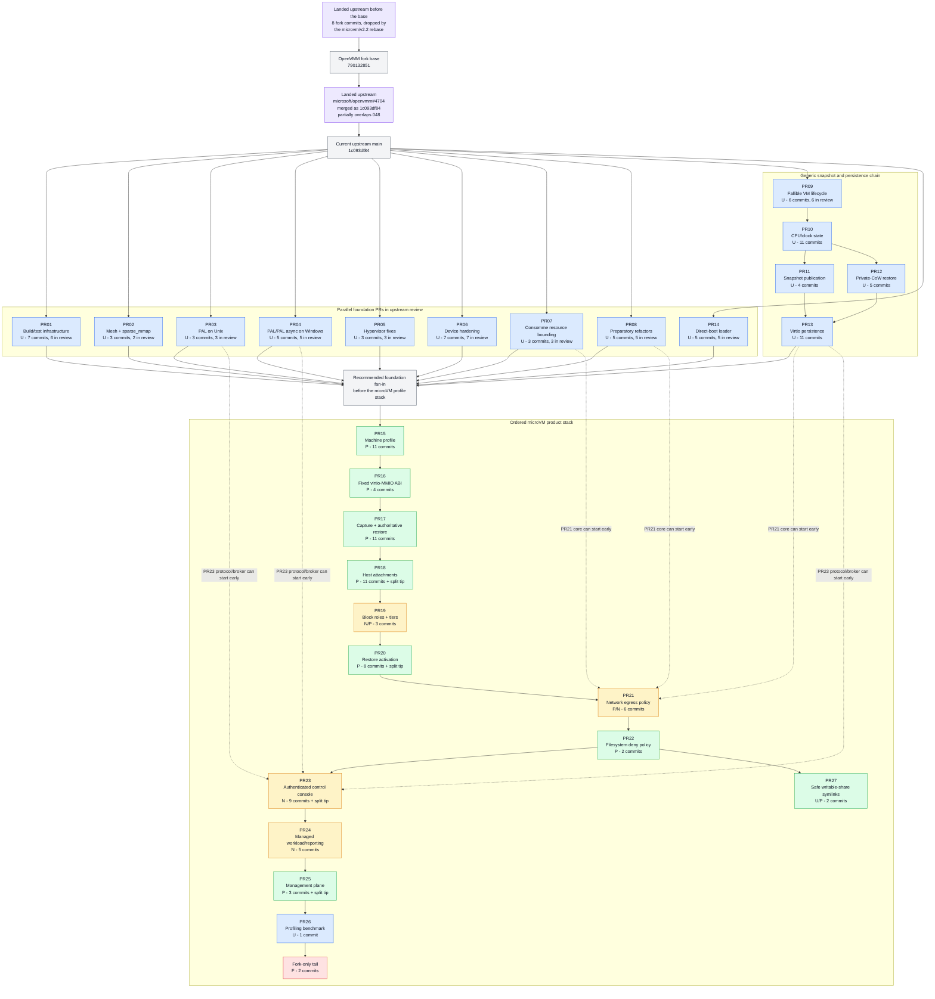

# OpenVMM Micro-VM PR Strategy

## Scope

- OpenVMM fork base: `79013285114700cf3e13e2f39353d526791d833b`, upstream main on 2026-10-16.
  The `microvm/v2.2` rebase, which NVX adopted in `a6a46bebf`, moved the chain there from
  `e1cdbd916d3aacb216309c8e7779b832546759a1`; see [Upstream status](#upstream-status).
- Mapped fork tip: `78de4d4cb052f02b983e96cde877ee4ce06eae8b`, position 158. The graph, PR
  summary, and commit mapping below cover positions 001-158.
- NVX's pinned OpenVMM revision: `d0bdbed8f6e3b86271277dc22658109e2e633b2d`, the head of the
  `feature/microvm/dev` branch of microsoft/openvmm, 154 commits past the mapped tip on the same
  first-parent chain. These commits are not yet assigned to PRs; see
  [Commits after the mapped tip](#commits-after-the-mapped-tip).
- Upstream main: `1c093df84eb4277244fe0d70a7d4c39db5dafc88` (2026-10-20), 17 commits past
  the fork base.

## Upstream status

The `microvm/v2.2` rebase moved the 320-commit chain of `microvm/v2.1` from `e1cdbd916` onto
`790132851`, 75 upstream commits later. It dropped the eight fork commits that had landed
upstream in between and adapted the remaining 312 to upstream API changes where they needed it,
which changed the diffs of 50 of them. Positions from 002 on are therefore lower than in
`microvm/v2.1` and in earlier revisions of this document.

### Landed upstream

| v2.1 position | Fork commit | Roadmap PR | Upstream PR | Upstream commit |
| ---: | --- | --- | --- | --- |
| 002 | `607e6c6a2` - nextest: scope a longer budget to the exhaustive ring-buffer loom test | PR01 | microsoft/openvmm#4584 | `9501bb481` |
| 017 | `c61d77644` - pal: create files and directories with explicit security descriptors | PR04 | microsoft/openvmm#4599 | `9fbf965c5` |
| 021 | `88865bf90` - virt_mshv: describe SNP guest workarounds without ACI-specific names | PR05 | microsoft/openvmm#4580 | `40cff1268` |
| 022 | `9b3ce6760` - kvm: preserve pending external interrupts across VP-state capture | PR05 | microsoft/openvmm#4522 | `392890680` |
| 029 | `947ae858b` - virtio: make interrupt tests wait for queue completion | PR06 | microsoft/openvmm#4592 | `5b4656a86` |
| 030 | `21c2206c9` - fuse: rate-limit guest-triggerable diagnostics | PR06 | microsoft/openvmm#4581 | `926827446` |
| 035 | `54c5c34cd` - virtio_console: rate-limit worker errors | PR06 | microsoft/openvmm#4614 | `77ce2aeac` |
| 039 | `dd349021e` - openvmm_entry: accept `delay:<ms>:<disk>` disk wrappers | PR08 | microsoft/openvmm#4610 | `6e0e4fdab` |

microsoft/openvmm#4522 fixes the lost-PIC-interrupt bug of v2.1 position 022 in a different way.
Instead of tracking the queued vector in `kvm::VpRunner`, it injects PIC interrupts through the
vCPU's injected-interrupt slot (`KVM_SET_VCPU_EVENTS`), which the existing activity save/restore
already covers. Fork builds that include `9b3ce6760`, such as those of `microvm/v2.1`, can save a
queued PIC vector as a pending `ExtInt` event. Current builds reject restoring one with
`KvmError::InvalidState`, so recapture KVM snapshots that those builds captured.

Upstream also landed parts of commits that remain in the chain:

- microsoft/openvmm#4556 (`96647c331`) derives `Clone` for `ProtobufMessage` and `ProtobufAny`.
  Position 008 keeps its subject but now only adds `ProtobufAny::value_len` and checks a clone
  in the round-trip test.
- microsoft/openvmm#4524 (`9cf109547`) adds the generic `PartitionTimeControl` contract, MSHV
  and WHP implementations, and full-VM freeze/thaw lifecycle calls. Position 051 now reuses the
  MSHV implementation, through fallible freeze and thaw helpers, instead of private plumbing.
  Positions 049-053 and the position 152 fixup keep the exact TSC-frequency exposure, snapshot
  downtime handling, and restored-vCPU synchronization that upstream lacks.

### Open upstream pull requests

As of 2026-10-20, every commit of PR01-PR09 and PR14 except positions 001 and 008 is in an open
upstream pull request. Each pull request carries one commit, except microsoft/openvmm#4554, which
carries positions 074-077; its ELF and initrd validation was split out during review and landed
as microsoft/openvmm#4667 (`a87971184`). None of the 42 pull requests is a draft, and none has an
approving review yet. microsoft/openvmm#4451, which proposed position 001, was closed without
merging, and the remainder of position 008 has not been proposed. PR10-PR13 and PR15-PR27 have no
upstream pull requests yet.

| Roadmap PR | Positions | Upstream pull requests, in position order |
| --- | ---: | --- |
| PR01 | 002-007 | microsoft/openvmm#4595, microsoft/openvmm#4608, microsoft/openvmm#4618, microsoft/openvmm#4587, microsoft/openvmm#4598, microsoft/openvmm#4615 |
| PR02 | 009-010 | microsoft/openvmm#4557, microsoft/openvmm#4558 |
| PR03 | 011-013 | microsoft/openvmm#4589, microsoft/openvmm#4590, microsoft/openvmm#4591 |
| PR04 | 014-018 | microsoft/openvmm#4593, microsoft/openvmm#4596, microsoft/openvmm#4604, microsoft/openvmm#4582, microsoft/openvmm#4585 |
| PR05 | 019-021 | microsoft/openvmm#4536, microsoft/openvmm#4607, microsoft/openvmm#4613 |
| PR06 | 022-028 | microsoft/openvmm#4583, microsoft/openvmm#4586, microsoft/openvmm#4588, microsoft/openvmm#4594, microsoft/openvmm#4597, microsoft/openvmm#4605, microsoft/openvmm#4609 |
| PR07 | 029-031 | microsoft/openvmm#4600, microsoft/openvmm#4601, microsoft/openvmm#4602 |
| PR08 | 032-036 | microsoft/openvmm#4616, microsoft/openvmm#4617, microsoft/openvmm#4620, microsoft/openvmm#4621, microsoft/openvmm#4606 |
| PR09 | 037-042 | microsoft/openvmm#4619, microsoft/openvmm#4622, microsoft/openvmm#4623, microsoft/openvmm#4624, microsoft/openvmm#4625, microsoft/openvmm#4626 |
| PR14 | 074-078 | microsoft/openvmm#4554 (074-077), microsoft/openvmm#4611 |

Stacked pull requests carry their prerequisites' commits: microsoft/openvmm#4585 builds on
microsoft/openvmm#4582, and microsoft/openvmm#4609 on both; microsoft/openvmm#4613 builds on
microsoft/openvmm#4536; and microsoft/openvmm#4622, microsoft/openvmm#4623, and
microsoft/openvmm#4625 build on microsoft/openvmm#4619, as microsoft/openvmm#4626 builds on
microsoft/openvmm#4625. Most of these pull requests have gained review commits that the fork
chain does not carry. When one merges, the next rebase should drop its fork commit, as the
`microvm/v2.2` rebase dropped the eight above, and adapt later commits to the merged form.

### Upstream main past the fork base

Replaying the chain onto upstream main at `1c093df84` with `git merge-tree` conflicts at seven
positions; the other 305 commits apply cleanly. Of the 17 upstream commits, only
microsoft/openvmm#4704 overlaps fork work; the other conflicts are textual.

| Position | Fork commit | Upstream PR | Conflicting files |
| ---: | --- | --- | --- |
| 020 | `0526930f3` - virt: add Partition::finalize_memory; create the MSHV BSP after finalization | microsoft/openvmm#4703 | `vmm_core/virt_mshv/src/x86_64/mod.rs` |
| 044 | `093dba2c0` - chipset: persist and advance the RTC clock | microsoft/openvmm#4661 | `Cargo.lock` |
| 048 | `3bae4cdf6` - virt: add portable TSC-deadline VP state and APIC-timer advance | microsoft/openvmm#4704 | `vmm_core/virt/src/x86/mod.rs`, `vmm_core/virt/src/x86/vp.rs`, `vmm_core/virt_mshv/src/x86_64/mod.rs` |
| 078 | `c53846f12` - vmm_core: make level-triggered legacy IRQs explicit | microsoft/openvmm#4661 | `vm/loader/igvmfilegen/src/snp_linux_direct.rs` |
| 089 | `08bf39d78` - petri, vmm_tests: add a microVM builder, portb harness, and cold-boot test | microsoft/openvmm#4709 | `petri/src/vm/mod.rs` |
| 150 | `6a4109674` - ci: restrict privileged, self-hosted, and publishing jobs to microsoft/openvmm | microsoft/openvmm#4709 | `.github/workflows/openvmm-ci.yaml`, `.github/workflows/openvmm-pr.yaml`, `.github/workflows/openvmm-pr-release.yaml` |
| 164 | `8051a40a3` - virt_mshv: implement the NVX time ABI backend | microsoft/openvmm#4703 | `vmm_core/virt_mshv/src/lib.rs`, `vmm_core/virt_mshv/src/x86_64/mod.rs` |

microsoft/openvmm#4704 (`1c093df84`) adds the architectural `TscDeadline` VP state element, the
`tsc_deadline` partition capability, and the KVM, MSHV, WHP, and OpenHCL register accessors that
position 048 also adds, and it likewise reports no TSC-deadline support on MSHV. Rework 048 onto
that element and keep only its `Apic::advance_timer` and `Apic::advance_tsc_deadline` helpers,
their tests, and the `tsc_deadline` field of the CPU compatibility contract. Upstream compares
the restored deadline when the partition can freeze time, whereas 048 never compares it, since it
can expire between restore and readback.

microsoft/openvmm#4703 (`284127421`) resets MSHV partitions through the partition scrub ioctl,
which the MSHV changes of positions 020 and 164 must adapt to. microsoft/openvmm#4661 rewrites
the SNP Linux-direct layout in `igvmfilegen`, whose ACPI configuration position 078 extends with
level-triggered IRQs, and microsoft/openvmm#4709 changes the petri VM code that position 089
extends. Regenerate `Cargo.lock` and the generated workflows rather than merging them by hand.

## Legend

| Class | Meaning |
| --- | --- |
| U | Independently upstreamable |
| P | Upstreamable as part of an accepted microVM profile |
| N | NVX product policy; fork-only unless generalized |
| F | Fork-only |

Solid arrows in the diagram are the recommended landing/stacking order. Dashed arrows show work
that can start before the product stack reaches that PR. Purple nodes mark upstream changes that
supersede or partially overlap fork work. "In review" counts a node's commits that are in open
upstream pull requests.

## PR Dependency and Submission Graph



## Actual branch DAG

The physical branch is one first-parent chain:

```text
790132851
  -> PR01 [001-007] -> PR02 [008-010] -> PR03 [011-013]
  -> PR04 [014-018] -> PR05 [019-021] -> PR06 [022-028]
  -> PR07 [029-031] -> PR08 [032-036] -> PR09 [037-042]
  -> PR10 [043-053] -> PR11 [054-057] -> PR12 [058-062]
  -> PR13 [063-073] -> PR14 [074-078] -> PR15 [079-089]
  -> PR16 [090-093] -> PR17 [094-104] -> PR18 [105-114]
  -> PR19 [115-117] -> PR20 [118-124] -> PR21 [125-130]
  -> PR22 [131-132] -> PR23 [133-141] -> PR24 [142-146]
  -> PR25 [147-148] -> PR26 [149] -> fork tail [150-151]
  -> PR20 fixup [152] -> PR20/PR25 split [153]
  -> PR18/PR23 split [154]
  -> PR18 fixup [155] -> PR25 fixup [156] -> PR27 [157-158]
  -> 78de4d4cb (mapped tip)
  -> unassigned [159-312] -> d0bdbed8f (NVX pin)
```

For upstream review, PR01-PR08 and PR14 can be rebased independently onto current upstream main,
and nearly all of their commits are already in upstream review; see
[Open upstream pull requests](#open-upstream-pull-requests). PR09-PR13 form the generic dependency
chain shown above. The recommended product queue then fans those foundations into PR15 and keeps
PR15-PR26 ordered. PR21's generic enforcement commits can be prepared after PR07, PR08, and PR13;
PR23's protocol and broker commits can be prepared after PR03, PR04, and PR13. Positions 150-151
remain outside the upstream queue. Fold position 152 into PR20, split position 153 between PR20
and PR25, and split position 154 between PR18 and PR23 before submission. Fold position 155 into
PR18's position 105 and position 156 into PR25's position 147. PR27 can be prepared once PR22
lands; its generic confinement commit can be submitted independently if preferred.

## Commits after the mapped tip

The NVX pin extends the chain past position 158 without merges. The 154 later commits are not
yet classified or assigned to PRs. This table groups them by topic in chain order; ranges are
inclusive, as in the [PR summary](#pr-summary).

| Positions | Commit range | Count | Topic |
| ---: | --- | ---: | --- |
| 159 | `8e221ce05` | 1 | Flush buffered portb output before a guest-requested snapshot |
| 160-270 | `f011d9be6..f25e17b6d` | 111 | NVX time ABI v1 on KVM, MSHV, and WHP; pinned CPU profiles and the `--cpu-fingerprint` tool; removal of the legacy microVM clock paths; snapshot manifest version 6 as the only format; and MSHV and WHP delivery of LAPIC vectors written into a halted VP's IRR |
| 271-272 | `9c6215e4c..4463d99be` | 2 | Serve microVM virtio-fs share requests as the guest caller |
| 273-275 | `5e958169d..1aee05629` | 3 | Alder Lake CPU profile and opt-in host CPU profiles |
| 276-277 | `955e51575..d8dd256af` | 2 | Second microVM virtio-fs slot, which position 294 removes |
| 278-283 | `5833e3a30..6f50a4996` | 6 | AMD CPU profiles (Milan, Genoa, and Turin) and AMD host profiles |
| 284 | `cf62fcb9f` | 1 | Per-subtree access policy for microVM shares |
| 285 | `eff7e5a6b` | 1 | WHP answers CPUID leaves 0 and 1 without exits |
| 286-288 | `81d379238..02165ef38` | 3 | Generation-bound microVM snapshots and scratch bound by file identity |
| 289 | `cfd1ea7f3` | 1 | `--cpu-profile auto` falls back to a host profile |
| 290 | `98b3ab859` | 1 | RAM-backed microVM overlays without scratch |
| 291-293 | `77ccec52e..da5c20187` | 3 | Egress rules that select a protocol or a destination-port range, and IPv6 in the portable network profile |
| 294-297 | `4f5c7f854..addbb4d78` | 4 | Several host directories on one virtio-fs slot, their snapshot, and their path policy |
| 298-300 | `ca89a81f2..5bf2d528b` | 3 | Single host files as aggregate virtio-fs children, their saved kinds, and the `file` flag that requests one |
| 301 | `82434ac14` | 1 | Partition halt state across snapshots |
| 302-303 | `091dd30fa..fa1501908` | 2 | Restore advances VM time and the RTC by the downtime plus the recorded interval from their stop at capture to the capture anchor |
| 304 | `bb013bef5` | 1 | Tests of `RENAME_EXCHANGE` on microVM virtio-fs shares: node names, the alias limits, and snapshots |
| 305-306 | `9f6b51421..acdbf06d2` | 2 | Host paths with commas in `--mount`, whose mode follows the last comma |
| 307 | `f4a6a2413` | 1 | Private-network ingress: `--network-ingress allow` publishes the guest's announced listeners to clients on the host's private networks |
| 308 | `6d520c28c` | 1 | Bidirectional host-loopback access: `--host-loopback allow` publishes the guest's announced listeners on host loopback for the host alone |
| 309 | `7842f055b` | 1 | IPv6 host peers appear inside the static IPv6 subnet, so the guest answers them from its address there |
| 310 | `2362eb053` | 1 | Standalone time ABI documentation: comments describe the contract without citing NVX's removed specification |
| 311 | `c552dd441` | 1 | Replies of the host-loopback services that the guest reaches at its gateway come from the gateway, so connected guest UDP sockets receive them |
| 312 | `d0bdbed8f` | 1 | The VM worker stops its devices before it tears down the partition and guest memory, so no device worker reads guest memory that teardown has unmapped |

Some of these commits change mapped work rather than add to it. Positions 247-251 remove the
legacy microVM clock paths and change files that PR10 and PR17 also change. Position 253 makes
manifest version 6 the only snapshot format and changes files that PR11 and PR17 also change.
Assigning the later commits therefore means revisiting those PRs, not only appending new ones.

## PR summary

`N + split` means N whole commits plus selected hunks from a physical commit. Fixup positions count
as whole physical commits here but should be folded into their target commits before submission.

| PR | Class | Topic | Actual positions | Actual commit range(s) | Count | Recommended direct dependency |
| --- | --- | --- | ---: | --- | ---: | --- |
| PR01 | U | Build and test infrastructure | 001-007 | `d5b7c1b7c..38b181d81` | 7 | Current upstream |
| PR02 | U | Host primitives: mesh and sparse_mmap | 008-010 | `a6b97b7d2..865fa3dbe` | 3 | Current upstream |
| PR03 | U | Host primitives: PAL on Unix | 011-013 | `89016f048..6e3e49995` | 3 | Current upstream |
| PR04 | U | Host primitives: PAL and PAL async on Windows | 014-018 | `62becf79d..403980233` | 5 | Current upstream |
| PR05 | U | Hypervisor backend fixes | 019-021 | `00c3a3763..225b4e9dc` | 3 | Current upstream |
| PR06 | U | Device fixes and hardening | 022-028 | `5e0441363..a77bc9dfb` | 7 | Current upstream |
| PR07 | U | Consomme resource bounding | 029-031 | `dfb2edc88..b0c311532` | 3 | Current upstream |
| PR08 | U | Preparatory refactors | 032-036 | `a278b2a6f..301beb61d` | 5 | Current upstream |
| PR09 | U | Fallible and bounded VM lifecycle | 037-042 | `80275e2fd..0c4164067` | 6 | Current upstream |
| PR10 | U | Portable CPU and clock state | 043-053 | `a312829aa..d39ee8176` | 11 | PR09; rework 048 onto microsoft/openvmm#4704 |
| PR11 | U | Snapshot publication protocol | 054-057 | `4564cbcb9..86a264d7a` | 4 | PR10 |
| PR12 | U | Immutable private-CoW restore | 058-062 | `d09e62c3d..16ce8aa2a` | 5 | PR10 |
| PR13 | U | Generic virtio persistence | 063-073 | `896859c5c..6f5254f23` | 11 | PR11 + PR12 |
| PR14 | U | Firmware-less direct boot, loader half | 074-078 | `f6e6ff738..c53846f12` | 5 | Current upstream |
| PR15 | P | microVM machine profile and minimal chipset | 079-089 | `8e37dc675..08bf39d78` | 11 | Foundation fan-in |
| PR16 | P | Fixed virtio-MMIO ABI and shared interrupt status | 090-093 | `fb9ceb4dc..d039ac155` | 4 | PR15 |
| PR17 | P | microVM snapshot capture and authoritative restore | 094-104 | `6e893b114..45a6ebfc3` | 11 | PR16 |
| PR18 | P | microVM host attachments and device persistence | 105-114; 154 (split); 155 (fixup) | `fdc009d81..f02713200`; `38f893972` (split); `7d83e8139` | 11 + split | PR17 |
| PR19 | N/P | Sandbox block roles and snapshot tiers | 115-117 | `b216fc018..f72153553` | 3 | PR18 |
| PR20 | P | Restore-time processor and memory activation | 118-124; 152-153 | `4eb423026..b27fe4cc9`; `ed3afd225..a63be0253` | 8 + split | PR19 |
| PR21 | P/N | Network egress policy | 125-130 | `3c350752c..23ab8bdb8` | 6 | PR20; core can start after PR07 + PR08 + PR13 |
| PR22 | P | Filesystem deny policy | 131-132 | `e823f286d..a4686f2d3` | 2 | PR21 |
| PR23 | N | Authenticated control console | 133-141; 154 (split) | `f77c16b62..9b6fff506`; `38f893972` (split) | 9 + split | PR22; protocol/broker can start after PR03 + PR04 + PR13 |
| PR24 | N | Managed workload and outcome reporting | 142-146 | `0ad88f9fb..ac1b3f509` | 5 | PR23 |
| PR25 | P | Management plane | 147-148; 153 (split); 156 (fixup) | `7ec02fec6..bb792df41`; `a63be0253` (split); `679429191` | 3 + split | PR24 |
| PR26 | U | Profiling benchmark | 149 | `422b062f1` | 1 | PR25 in the current stack |
| PR27 | U/P | Safe symlinks for writable microVM shares | 157-158 | `fee7813fc..78de4d4cb` | 2 | PR22; position 157 can land independently |
| Fork tail | F | CI guards and NVX wire compatibility | 150-151 | `6a4109674..c8e76f1c8` | 2 | PR26; do not submit upstream |

## Exact commit-to-PR mapping

Positions 153 and 154 intentionally appear under two PRs because their commits must be split when
forming submission branches. Positions 155 and 156 are fixups that should be folded into positions
105 and 147, respectively. Tip positions 152-156 are listed under their destination PRs rather
than in numerical order. The counts distinguish whole commits from selected split hunks.
Struck-through entries landed upstream before the fork base. The `microvm/v2.2` rebase dropped
them, so they name their `microvm/v2.1` commits and positions, and the counts exclude them.
Partial upstream overlap is called out without striking the remaining fork work, and
**open upstream** names the upstream pull request that carries a commit.

<details>
<summary><strong>PR01 - Build and test infrastructure (U)</strong> - 7 commits + 1 landed upstream</summary>

- 001 `d5b7c1b7c` - build: keep Winsock eagerly imported on Windows (**not upstream**: microsoft/openvmm#4451 was closed without merging)
- ~~`607e6c6a2` - nextest: scope a longer budget to the exhaustive ring-buffer loom test~~
  (**landed upstream**: microsoft/openvmm#4584, merged as `9501bb481`; v2.1 position 002)
- 002 `a5aca26f3` - flowey: distinguish native Windows and WSL nextest paths (**open upstream**: microsoft/openvmm#4595)
- 003 `5b51fec11` - flowey: skip reinstalling an identical, possibly running cargo-nextest binary (**open upstream**: microsoft/openvmm#4608)
- 004 `029587d87` - flowey: keep caller temp directories for native local VMM-test runs (**open upstream**: microsoft/openvmm#4618)
- 005 `60122fa17` - lxutil: tolerate inherited extended attributes in tests (**open upstream**: microsoft/openvmm#4587)
- 006 `48c79c264` - consomme: make TCP window-reopen validation deterministic (**open upstream**: microsoft/openvmm#4598)
- 007 `38b181d81` - virt_whp, petri: enable native PCIe NVMe boot on WHP (**open upstream**: microsoft/openvmm#4615)

</details>

<details>
<summary><strong>PR02 - Host primitives: mesh and sparse_mmap (U)</strong> - 3 commits</summary>

- 008 `a6b97b7d2` - mesh_protobuf: clone type-erased messages and expose encoded length (**partly landed upstream**: microsoft/openvmm#4556, merged as `96647c331`, derives `Clone`; this commit now adds only `ProtobufAny::value_len` and a clone check)
- 009 `a4aaadf1b` - sparse_mmap: add private copy-on-write file views (**open upstream**: microsoft/openvmm#4557)
- 010 `865fa3dbe` - sparse_mmap: flush file-backed ranges with bounded concurrency (**open upstream**: microsoft/openvmm#4558)

</details>

<details>
<summary><strong>PR03 - Host primitives: PAL on Unix (U)</strong> - 3 commits</summary>

- 011 `89016f048` - pal: bound Linux descriptor-table pre-expansion (**open upstream**: microsoft/openvmm#4589)
- 012 `6f53531c2` - pal: add Unix extent cloning and sparse-extent seeking (**open upstream**: microsoft/openvmm#4590)
- 013 `6e3e49995` - pal: query Unix socket peer credentials (**open upstream**: microsoft/openvmm#4591)

</details>

<details>
<summary><strong>PR04 - Host primitives: PAL and PAL async on Windows (U)</strong> - 5 commits + 1 landed upstream</summary>

- 014 `62becf79d` - pal: add handle-relative file access that does not follow reparse points (**open upstream**: microsoft/openvmm#4593)
- 015 `95da9c2ae` - pal: add sparse-file range queries, zeroing, and block cloning (**open upstream**: microsoft/openvmm#4596)
- ~~`c61d77644` - pal: create files and directories with explicit security descriptors~~
  (**landed upstream**: microsoft/openvmm#4599, merged as `9fbf965c5`; v2.1 position 017)
- 016 `9f8a78a30` - pal: resolve the process token user SID (**open upstream**: microsoft/openvmm#4604)
- 017 `9db8f8e65` - pal: query named-pipe peers and create protected pipes (**open upstream**: microsoft/openvmm#4582)
- 018 `403980233` - pal_async: fix named-pipe reconnect and already-connected listen (**open upstream**: microsoft/openvmm#4585, stacked on microsoft/openvmm#4582)

</details>

<details>
<summary><strong>PR05 - Hypervisor backend fixes (U)</strong> - 3 commits + 2 landed upstream</summary>

- ~~`88865bf90` - virt_mshv: describe SNP guest workarounds without ACI-specific names~~
  (**landed upstream**: microsoft/openvmm#4580, merged as `40cff1268`; v2.1 position 021)
- ~~`9b3ce6760` - kvm: preserve pending external interrupts across VP-state capture~~
  (**landed upstream**: superseded by microsoft/openvmm#4522, merged as `392890680`; v2.1 position 022)
- 019 `00c3a3763` - virt_mshv: make RUN_VP cancellation race-free (**open upstream**: microsoft/openvmm#4536)
- 020 `0526930f3` - virt: add Partition::finalize_memory; create the MSHV BSP after finalization (**open upstream**: microsoft/openvmm#4607)
- 021 `225b4e9dc` - virt_mshv: persist and redeliver pending external interrupts (**open upstream**: microsoft/openvmm#4613, stacked on microsoft/openvmm#4536)

</details>

<details>
<summary><strong>PR06 - Device fixes and hardening (U)</strong> - 7 commits + 3 landed upstream</summary>

- 022 `5e0441363` - chipset: preserve IOAPIC line levels across restore (**open upstream**: microsoft/openvmm#4583)
- 023 `91191e0b4` - chipset: fast-forward periodic PIT counting over long intervals (**open upstream**: microsoft/openvmm#4586)
- 024 `2b8adf18c` - virtio_blk: let stop cancellation win over a ready queue and drain accepted I/O (**open upstream**: microsoft/openvmm#4588)
- ~~`947ae858b` - virtio: make interrupt tests wait for queue completion~~
  (**landed upstream**: microsoft/openvmm#4592, merged as `5b4656a86`; v2.1 position 029)
- ~~`21c2206c9` - fuse: rate-limit guest-triggerable diagnostics~~
  (**landed upstream**: microsoft/openvmm#4581, merged as `926827446`; v2.1 position 030)
- 025 `0ada18873` - virtiofs: make handle and inode ID allocation fallible (**open upstream**: microsoft/openvmm#4594)
- 026 `4fa9783be` - virtiofs: bound guest payload allocations and rate-limit diagnostics (**open upstream**: microsoft/openvmm#4597)
- 027 `742577440` - serial_socket: drop the connection on any write failure (**open upstream**: microsoft/openvmm#4605)
- 028 `a77bc9dfb` - serial_socket: keep Windows named-pipe listeners reconnectable (**open upstream**: microsoft/openvmm#4609, stacked on microsoft/openvmm#4582 and microsoft/openvmm#4585)
- ~~`54c5c34cd` - virtio_console: rate-limit worker errors~~
  (**landed upstream**: microsoft/openvmm#4614, merged as `77ce2aeac`; v2.1 position 035)

</details>

<details>
<summary><strong>PR07 - Consomme resource bounding (U)</strong> - 3 commits</summary>

- 029 `dfb2edc88` - consomme: bound active TCP, UDP, and ICMP flows (**open upstream**: microsoft/openvmm#4600)
- 030 `8336e6791` - consomme: cover the pending DNS request limit with a test (**open upstream**: microsoft/openvmm#4601)
- 031 `b0c311532` - consomme: cover IPv4 fragment rejection with a test (**open upstream**: microsoft/openvmm#4602)

</details>

<details>
<summary><strong>PR08 - Preparatory refactors (U)</strong> - 5 commits + 1 landed upstream</summary>

- ~~`dd349021e` - openvmm_entry: accept `delay:<ms>:<disk>` disk wrappers~~
  (**landed upstream**: microsoft/openvmm#4610, merged as `6e0e4fdab`; v2.1 position 039)
- 032 `a278b2a6f` - openvmm_helpers: split the snapshot module without behavior changes (**open upstream**: microsoft/openvmm#4616)
- 033 `a23d99e32` - net_tap: move the transmit path into its own module (**open upstream**: microsoft/openvmm#4617)
- 034 `85d989881` - net_consomme: move queue transmit processing into a module (**open upstream**: microsoft/openvmm#4620)
- 035 `635138620` - virtio_console: move the direct receive loop into its own module (**open upstream**: microsoft/openvmm#4621)
- 036 `301beb61d` - openvmm_entry: skip raw console mode when stdin is not a terminal (**open upstream**: microsoft/openvmm#4606)

</details>

<details>
<summary><strong>PR09 - Fallible and bounded VM lifecycle (U)</strong> - 6 commits</summary>

- 037 `80275e2fd` - state_unit: make unit start fallible and roll back partial starts (**open upstream**: microsoft/openvmm#4619)
- 038 `e6d7f6a43` - vmcore: add fallible device start through chipset device workers (**open upstream**: microsoft/openvmm#4622, stacked on microsoft/openvmm#4619)
- 039 `028f4c119` - openvmm: make VM resume fallible (**open upstream**: microsoft/openvmm#4623, stacked on microsoft/openvmm#4619)
- 040 `c5da19504` - state_unit: record the exact unit inventory in saved state (**open upstream**: microsoft/openvmm#4624)
- 041 `aeabf4563` - state_unit: add bounded quiesce transactions with rollback classification (**open upstream**: microsoft/openvmm#4625, stacked on microsoft/openvmm#4619)
- 042 `0c4164067` - vmcore: add device input quiesce and resume (**open upstream**: microsoft/openvmm#4626, stacked on microsoft/openvmm#4625)

</details>

<details>
<summary><strong>PR10 - Portable CPU and clock state (U)</strong> - 11 commits</summary>

- 043 `a312829aa` - vmcore, state_unit: advance guest time across stopped downtime
- 044 `093dba2c0` - chipset: persist and advance the RTC clock
- 045 `133ea18f6` - chipset: reject inconsistent RTC interrupt state on restore
- 046 `5b48e5245` - chipset: catch up the PIT after downtime
- 047 `715b7c016` - virt: define a canonical x86 CPU compatibility contract
- 048 `3bae4cdf6` - virt: add portable TSC-deadline VP state and APIC-timer advance (**partly superseded upstream**: microsoft/openvmm#4704, merged as `1c093df84` after the fork base, adds the same `TscDeadline` state element and backend accessors)
- 049 `2676cdb42` - virt: add exact TSC-frequency helpers and snapshot clock hooks
- 050 `8109e4539` - virt_kvm: save and restore exact TSC and kvm-clock state
- 051 `e50bfae7e` - virt_mshv: synchronize restored vCPU clocks and expose the exact TSC frequency
- 052 `156c9c76d` - virt_whp: synchronize restored vCPU clocks and keep SMP TSC reads coherent
- 053 `d39ee8176` - vmm_core: advance VP TSC and APIC timers across downtime

Position 048 partially overlaps microsoft/openvmm#4704, which landed after the fork base;
see [Upstream main past the fork base](#upstream-main-past-the-fork-base). Position 051
already reuses the MSHV `PartitionTimeControl` implementation of microsoft/openvmm#4524 and
keeps only the exact-frequency and restored-TSC synchronization work that upstream lacks.

</details>

<details>
<summary><strong>PR11 - Snapshot publication protocol (U)</strong> - 4 commits</summary>

- 054 `4564cbcb9` - openvmm_defs: add opt-in snapshot lifecycle profiling
- 055 `ff7761147` - openvmm_helpers: version the snapshot manifest format and bound its decoding
- 056 `4e82cd58e` - openvmm_helpers: publish snapshots atomically through durable staging
- 057 `86a264d7a` - openvmm: publish the exact file-backed RAM handle

</details>

<details>
<summary><strong>PR12 - Immutable private-CoW restore (U)</strong> - 5 commits</summary>

- 058 `d09e62c3d` - membacking: map guest RAM privately copy-on-write with fault accounting
- 059 `bc6709722` - openvmm_helpers: open snapshots once and read artifacts relative to the directory
- 060 `3dec60ba2` - openvmm: restore RAM through a private CoW mapping and retain generation handles
- 061 `39ee7232b` - openvmm: signal restore readiness to a local socket or pipe
- 062 `16ce8aa2a` - virt_whp: resolve unmapped-GPA faults and register restored RAM lazily

</details>

<details>
<summary><strong>PR13 - Generic virtio persistence (U)</strong> - 11 commits</summary>

- 063 `896859c5c` - virtio: add device-private saved state with deferred activation and serialized kicks
- 064 `5fbeed64d` - virtio: forward input quiesce and resume through transports
- 065 `e61a4943c` - virtio_console: add attachment identities and reconnect and disconnect policies
- 066 `26af5c611` - virtio_console: persist buffered direct-console I/O
- 067 `143b31a13` - net_backend: add an endpoint queue quiesce contract
- 068 `34e2f925f` - net_tap: quiesce queues and retain pending transmit ownership
- 069 `8cf5f220c` - net_consomme: quiesce endpoint queues
- 070 `f6e19efb3` - consomme: add an exact static IPv4 and gateway identity
- 071 `258676942` - virtio_net: persist drained queue state for static-identity NICs
- 072 `20ef9152e` - fuse: save and restore negotiated session state
- 073 `6f5254f23` - virtiofs: track inode aliases through link, rename, and unlink

</details>

<details>
<summary><strong>PR14 - Firmware-less direct boot, loader half (U)</strong> - 5 commits</summary>

- 074 `f6e6ff738` - loader_defs: name the boot_params ACPI RSDP field (**open upstream**: microsoft/openvmm#4554)
- 075 `86285a460` - loader: let static ELF loading reuse a caller buffer (**open upstream**: microsoft/openvmm#4554)
- 076 `87b320626` - loader: add an Intel MP 1.4 table builder (**open upstream**: microsoft/openvmm#4554)
- 077 `0c72e8288` - loader: add firmware-less Linux direct boot with MP tables (**open upstream**: microsoft/openvmm#4554)
- 078 `c53846f12` - vmm_core: make level-triggered legacy IRQs explicit (**open upstream**: microsoft/openvmm#4611)

</details>

<details>
<summary><strong>PR15 - microVM machine profile and minimal chipset (P)</strong> - 11 commits</summary>

- 079 `8e37dc675` - openvmm_defs: add machine-profile selection
- 080 `b160ba4ba` - virt: describe the deterministic microVM topology
- 081 `ab2c9b762` - chipset: add an RTC mode seam
- 082 `549e376f0` - vm_manifest_builder: add the minimal microVM base chipset without ACPI
- 083 `9aa7cd35f` - vmm_core: add status-bearing guest power-off
- 084 `23bf0699c` - chipset: add the microVM portb console
- 085 `de4a3f87b` - chipset: add the microVM shutdown and exit-status port
- 086 `a4e3fa834` - openvmm_core: boot microVMs through MP-table direct load
- 087 `edfe5dae9` - openvmm_core: reject host save, pulse save/restore, and worker restart for microVMs
- 088 `2a41a93a8` - openvmm_entry: expose `--machine microvm`
- 089 `08bf39d78` - petri, vmm_tests: add a microVM builder, portb harness, and cold-boot test

</details>

<details>
<summary><strong>PR16 - Fixed virtio-MMIO ABI and shared interrupt status (P)</strong> - 4 commits</summary>

- 090 `fb9ceb4dc` - virtio: allow feature masking for virtio-MMIO devices
- 091 `29b7702eb` - openvmm: place virtio devices at fixed microVM MMIO slots
- 092 `0878168cd` - virtio: add shared MMIO interrupt status and ACK doorbells
- 093 `d039ac155` - openvmm: use shared interrupt status for fixed microVM slots

</details>

<details>
<summary><strong>PR17 - microVM snapshot capture and authoritative restore (P)</strong> - 11 commits</summary>

- 094 `6e893b114` - vmm_core: stop VPs at a deferred-I/O boundary
- 095 `8736372d1` - chipset: add the microVM snapshot-request port
- 096 `32778bc7e` - openvmm_core: establish the post-OUT snapshot boundary in the worker
- 097 `ee04cab4d` - openvmm_core: fence management mutations during snapshot boundaries
- 098 `959edc3da` - openvmm_helpers: define the authoritative microVM machine contract
- 099 `08509c87a` - openvmm_core: propagate the guest TSC frequency for snapshot-capable cold boots
- 100 `80f69bea1` - openvmm_entry: capture guest-requested microVM snapshots
- 101 `f717672bf` - virt: build a reproducible CPU and clock contract for microVM partitions
- 102 `61bec002a` - openvmm_core: validate restored CPU and clock contracts and apply host downtime
- 103 `d06b744dc` - openvmm_entry: restore microVMs authoritatively
- 104 `45a6ebfc3` - vmm_tests: check that an unconfigured microVM snapshot request continues

</details>

<details>
<summary><strong>PR18 - microVM host attachments and device persistence (P)</strong> - 11 commits + split tip</summary>

- 105 `fdc009d81` - openvmm_entry: add connect= serial backends with bounded timeouts
- 106 `3249b5a3d` - openvmm: persist the microVM boot console and rebuild its attachment on restore
- 107 `40b8b34f1` - openvmm: attach a portable Consomme NIC to microVMs
- 108 `35ef208e0` - openvmm: persist the microVM NIC and restore a fresh endpoint generation
- 109 `c7d17705b` - net_tap: support persistent TAP attachments
- 110 `1fa49b00a` - virtiofs: add the fixed microVM filesystem profile
- 111 `ae19ee8e2` - openvmm_entry: expose `--mount` for the microVM HostFs slot
- 112 `889e5a30a` - virtiofs: persist microVM FUSE namespaces, handles, and directory cookies
- 113 `68283ff86` - openvmm: snapshot the microVM filesystem and revalidate it on restore
- 114 `f02713200` - openvmm: reserve a dormant microVM filesystem slot
- 154 `38f893972` - Restore listener endpoint rebinding (**split with PR23**: boot-listener and shared attachment-contract portions belong in PR18; authenticated control-listener portions belong in PR23)
- 155 `7d83e8139` - openvmm_entry: compile connect_serial without the RPC features (**fold into 105**)

</details>

<details>
<summary><strong>PR19 - Sandbox block roles and snapshot tiers (N/P)</strong> - 3 commits</summary>

- 115 `b216fc018` - openvmm: add fixed-role microVM sandbox block slots
- 116 `ec5be9fa0` - openvmm: snapshot sandbox blocks with paired or fresh scratch
- 117 `f72153553` - openvmm: add clone and resume tiers with single-use resume claims

</details>

<details>
<summary><strong>PR20 - Restore-time processor and memory activation (P)</strong> - 8 commits + split tip</summary>

- 118 `4eb423026` - chipset: expose a stable generation ID and restore entropy on portb
- 119 `2be2e6aa5` - openvmm: gate external input until post-restore repair completes
- 120 `a7686fe23` - vmm_core: instantiate an active VP prefix
- 121 `78e02e6da` - openvmm: bring a restore-time processor prefix online
- 122 `99609cf2e` - openvmm_core: back expandable restore RAM with fresh private memory
- 123 `e4f1c77fa` - openvmm: add bounded restore-time memory expansion
- 124 `b27fe4cc9` - openvmm_entry: pre-expand the Linux descriptor table at startup
- 152 `ed3afd225` - virt_mshv: synchronize restored TSCs only on created VPs
- 153 `a63be0253` - openvmm_core: instantiate only the requested VP prefix on MSHV restore (**split with PR25**: worker and backend changes belong in PR20; the gRPC reference hunk belongs in PR25)

</details>

<details>
<summary><strong>PR21 - Network egress policy (P/N)</strong> - 6 commits</summary>

- 125 `3c350752c` - net_backend_resources: define a canonical bound IPv4 egress policy
- 126 `9ed8803b6` - net_backend: let endpoints accept a run-scoped egress policy
- 127 `fdc5b1635` - net_consomme: enforce the egress policy on final transmitted bytes
- 128 `36cda051a` - net_tap: enforce the egress policy on TAP transmit
- 129 `751dabcfe` - virtio_net: install and prefilter the egress policy
- 130 `23ab8bdb8` - openvmm: add microVM network egress policy and bind it into snapshots

</details>

<details>
<summary><strong>PR22 - Filesystem deny policy (P)</strong> - 2 commits</summary>

- 131 `e823f286d` - virtiofs: enforce denied subtrees by object identity
- 132 `a4686f2d3` - openvmm: add --mount-deny and record denied paths in snapshots

</details>

<details>
<summary><strong>PR23 - Authenticated control console (N)</strong> - 9 commits + split tip</summary>

- 133 `f77c16b62` - serial_core: expose local peer identity and active-peer eviction
- 134 `96b658db8` - serial_socket: report Unix and named-pipe peer identities
- 135 `5d8e3f2f6` - virtio_console: define the control-session record protocol
- 136 `c712aa4f8` - virtio_console: add the control-session broker state machine
- 137 `091c85f7c` - virtio_console: attach the broker to serial I/O with receive credits
- 138 `ef009090b` - virtio_console: save and restore broker state
- 139 `3ad1c3e88` - openvmm: reserve the dedicated microVM control-console slot
- 140 `17e5de4ef` - openvmm_helpers: record the control console in the microVM machine contract
- 141 `9b6fff506` - openvmm_entry: add authenticated microVM control-console endpoints
- 154 `38f893972` - Restore listener endpoint rebinding (**split with PR18**: authenticated control-listener portions belong in PR23; boot-listener and shared attachment-contract portions belong in PR18)

</details>

<details>
<summary><strong>PR24 - Managed workload and outcome reporting (N)</strong> - 5 commits</summary>

- 142 `0ad88f9fb` - openvmm_entry: drain portb output before guest-requested exit
- 143 `3e475b08c` - openvmm: add a fixed non-root workload identity
- 144 `d0101677d` - openvmm: support a managed workload lifecycle
- 145 `db28f3c16` - openvmm_entry: write bounded microVM outcome reports
- 146 `ac1b3f509` - Guide: describe teardown after a failed snapshot boundary

</details>

<details>
<summary><strong>PR25 - Management plane (P)</strong> - 3 commits + split tip</summary>

- 147 `7ec02fec6` - vmservice: create, capture, and restore microVMs over the management RPC
- 148 `bb792df41` - ttrpc: propagate nonzero guest exit status
- 153 `a63be0253` - openvmm_core: instantiate only the requested VP prefix on MSHV restore (**split with PR20**: the gRPC reference hunk belongs in PR25; worker and backend changes belong in PR20)
- 156 `679429191` - openvmm_entry: gate RPC-only microVM helpers behind the RPC features (**fold into 147**)

</details>

<details>
<summary><strong>PR26 - Profiling benchmark (U)</strong> - 1 commit</summary>

- 149 `422b062f1` - openvmm_helpers: add a publication and private-restore benchmark

</details>

<details>
<summary><strong>PR27 - Safe symlinks for writable microVM shares (U/P)</strong> - 2 commits</summary>

- 157 `fee7813fc` - lxutil: add path confinement that never follows symbolic links
- 158 `78de4d4cb` - virtiofs: allow symlink creation on read-write microVM shares

</details>

<details>
<summary><strong>Fork-only tail (F)</strong> - 2 commits</summary>

- 150 `6a4109674` - ci: restrict privileged, self-hosted, and publishing jobs to microsoft/openvmm
- 151 `c8e76f1c8` - vmservice: keep NVX wire-tag compatibility

</details>
